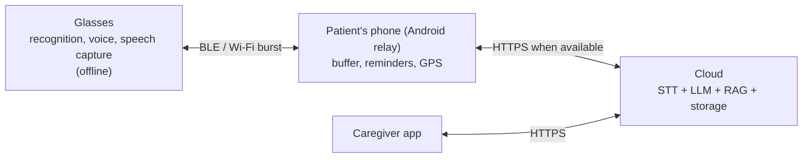

# Remori

**AI memory assistant smart glasses for Alzheimer's care.**

Graduation project · Artificial Intelligence Engineering · Faculty of Engineering, Mansoura University

---

## Overview

Remori pairs AI smart glasses with a cross-platform companion app (Flutter, Android + iOS) to help people living with Alzheimer's disease recognize the people around them, remember their day, and stay safely independent.

- **On the glasses:** face recognition, voice answers and speech capture run fully offline on the device. The name and relationship of a known person are spoken once per encounter.
- **Artificial memory:** what is said during the day is transcribed into a searchable journal ("What did Ahmed tell me this morning?"). Raw audio is deleted once transcribed.
- **On the phone:** a Flutter app with two modes. Patient Mode is a simple interface for the day, reminders, recall and mind games. Caregiver Mode is a dashboard for enrolling people, managing reminders and places, and monitoring activity.
- **In the cloud:** speech recognition, large language models, and retrieval-augmented generation (RAG) turn daily events into answers and caregiver summaries.

Video is never streamed. The glasses keep only what matters and discard the rest.

## Architecture



| Tier | Role | Needs internet? |
| --- | --- | --- |
| Glasses | Capture, face recognition, voice activity detection, intent recognition, speech output | No |
| Phone | Relay and offline buffer (Android), reminder sync and notifications, location, patient and caregiver apps (Android + iOS) | No (syncs when online) |
| Cloud | Transcription, LLM + RAG memory, smart media review, caregiver summaries | Yes, opportunistic |

Full specification: [`REMORI_SPEC.md`](REMORI_SPEC.md) · Diagrams: [`docs/diagrams/`](docs/diagrams/README.md)

## Tech stack

| Hardware | Software | Tools |
| --- | --- | --- |
| Raspberry Pi Zero 2W + ESP32-S3 | Python, C++, Dart | GitHub (monorepo) |
| OV5647 5MP camera | TFLite / ONNX Runtime (INT8) | Figma |
| I²S microphone + speaker | Whisper (speech-to-text), Piper (TTS) | Notion |
| Button, status LED, Li-Po battery | Hybrid RAG on pgvector, LLM APIs | PostgreSQL, SQLite (drift) |
| OLED AR display (stretch goal) | Flutter (Android + iOS), FastAPI | Docker, AWS |

**On-device AI:** Ultra-Light face detector, MobileFaceNet embeddings, Silero VAD, a custom Arabic/English intent classifier.
**Connectivity:** Bluetooth Low Energy between glasses and phone, Wi-Fi bursts for video. The phone's own Wi-Fi or cellular link reaches the cloud.

## Repository structure

```
├── flutter/       # Patient Mode and Caregiver Mode app (Android + iOS)
├── backend-ai/    # FastAPI, PostgreSQL, worker jobs, RAG pipeline
├── ml/            # Shared face pipeline, intent classifier, training and evaluation
├── hardware/      # Raspberry Pi runtime and ESP32 firmware
└── docs/          # Spec review, diagrams, interface contracts
```

## Plan

| Semester | Goal |
| --- | --- |
| 1 | A working offline device: face recognition with spoken names, voice assistant (button), reminders, BLE link to the phone, and a real Flutter caregiver app |
| 2 | Artificial memory pipeline (transcription + journal), LLM + RAG in Arabic and English, AI summaries for caregivers, full evaluation. AR overlay and wake word as stretch goals |

## Team

| # | Name |
| --- | --- |
| 1 | احمد مصطفى جمال الدين عبدالهادي (Team Leader) |
| 2 | أحمد محمد كمال زهر |
| 3 | عبدالرحمن أسامه السيد محمد |
| 4 | نوران محمد محمد احمد اسماعيل |
| 5 | ملك صدرالدين حسن عبدالرحمن |
| 6 | ملك محمد حسن الشرقاوي |
| 7 | آية وليد محمد محمد شحاتة |
| 8 | محمد هشام احمد الشربيني |

## Supervisors

- د/ دعاء الطنطاوي
- م/ احمد صميدة
