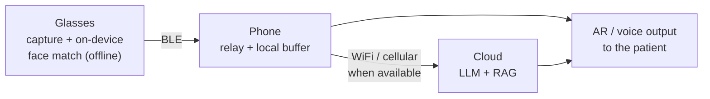

# MemoryOS

**AI memory assistant smart glasses with AR support for Alzheimer's care.**

Graduation project · Artificial Intelligence Engineering · Faculty of Engineering, Mansoura University

---

## Overview

MemoryOS pairs AI smart glasses with a companion mobile app to help people living with Alzheimer's disease recognize the people around them, recall context, and stay safely independent.

- **On the glasses:** face recognition and reminders run fully offline on the device. The name and relationship of a known person appear on the AR display in real time.
- **On the phone:** a Flutter app with two modes. Patient Mode is a simple interface for reminders and questions. Caregiver Mode is a dashboard for enrolling people and monitoring activity.
- **In the cloud:** speech recognition, large language models, and retrieval-augmented generation (RAG) turn daily events into a searchable memory ("Who is this?", "What did I do this morning?"), plus activity summaries for caregivers.

Raw video is never streamed. The glasses extract what they need on the device and discard the rest.

## Architecture



| Tier | Role | Needs internet? |
| --- | --- | --- |
| Glasses | Capture, voice activity detection, face detection and matching, AR overlay | No |
| Phone | Relay over Bluetooth, offline buffer, patient and caregiver apps | No (syncs when online) |
| Cloud | Speech-to-text, LLM + RAG memory, caregiver summaries | Yes, opportunistic |

The glasses never depend on a network. The phone buffers events while offline. The cloud adds long-term memory when a connection is available.

## Tech stack

| Hardware | Software | Tools |
| --- | --- | --- |
| Raspberry Pi Zero 2W + ESP32 | Python, C++, Dart | GitHub (monorepo) |
| Camera module (1080p) | TFLite / ONNX Runtime | Figma |
| Microphone array | Whisper (speech-to-text) | Notion |
| OLED / waveguide AR display | LangChain + vector DB (RAG) | PostgreSQL, SQLite |
| IMU, GPS, touch | Flutter | Docker, AWS |
| Rechargeable battery | FastAPI | |

**On-device AI:** Ultra-Light face detector, MobileFaceNet embeddings, Silero VAD, INT8-quantized models.
**Connectivity:** Bluetooth Low Energy between glasses and phone. The phone's own WiFi or cellular link reaches the cloud.

## Repository structure

```
memoryos/
├── flutter/       # Patient Mode and Caregiver Mode app
├── backend-ai/    # FastAPI, PostgreSQL, RAG pipeline, model training and quantization
├── hardware/      # Raspberry Pi and ESP32 firmware: capture, inference, BLE
└── docs/          # Architecture notes, interface contracts, proposal materials
```

## Plan

| Semester | Goal |
| --- | --- |
| 1 | A working offline device: face recognition, AR overlay, enrollment, BLE link to the phone, and a real Flutter caregiver app |
| 2 | Cloud memory pipeline (LLM + RAG), Arabic language support, AI summaries for caregivers, full evaluation |

## Team

| # | Name |
| --- | --- |
| 1 | احمد مصطفى جمال الدين عبدالهادي (Team Leader) |
| 2 | أحمد محمد كمال زهر |
| 3 | عبدالرحمن أسامه السيد محمد |
| 4 | نوران محمد محمد احمد اسماعيل |
| 5 | ملك صدرالدين حسن عبدالرحمن |
| 6 | ملك محمد حسن الشرقاوي |
| 7 | آية وليد محمد محمد شحاتة |
| 8 | محمد هشام احمد الشربيني |
## Supervisors

- د/ دعاء الطنطاوي
- م/ احمد صميدة
