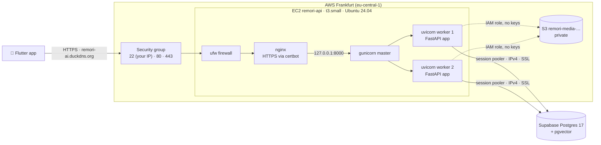

# Report: Phase 0, Phase 1 and the production setup

What was built between 11 Oct 2026 and now, why each piece exists, and how nginx and gunicorn/uvicorn workers will affect Remori.

Status: Phase 0 done (two manual items left), Phase 1 done in PR #2 (CI green, waiting for merge).

---

## 1. The big picture



Today, the boxes **outside** EC2 exist and work. **Inside** EC2, Docker is installed, but nginx, ufw, certbot and the app arrive in **Phase 4**. The app itself runs on your laptop (Phase 1).

---

## 2. Phase 0: infrastructure (done)

| Piece | What exists | Why |
|---|---|---|
| **Supabase** | Postgres **17.11**, pgvector 0.8.2 available, empty | The production database (spec D25) |
| **Supabase connection** | Session pooler `aws-1-eu-central-1.pooler.supabase.com:5432`, user `postgres.enbmqwddwxkhkjihxdxn`, SSL | The "direct" host is **IPv6-only**. Your network and EC2 only have IPv4, so the direct host can't be reached. The pooler speaks IPv4 |
| **EC2 `remori-api`** | t3.small (2 vCPU, 2 GB), Ubuntu 24.04, 20 GB disk, Docker 29 + Compose, git | The server that will run the API, and later the workers |
| **Elastic IP** | `18.184.27.33` | A fixed address that survives stop/start, so DNS never needs updating |
| **Domain** | `remori-ai.duckdns.org` → 18.184.27.33 | Required for an HTTPS certificate. Android refuses plain HTTP by default |
| **Security group `remori-api-sg`** | 22 only from your IP; 80/443 from anywhere | AWS-level firewall: nobody else can even try SSH |
| **SSH key `remori-ec2`** | `C:\Users\USER\.ssh\remori-ec2.pem` (only your Windows user can read it) | Log in: `ssh -i ~/.ssh/remori-ec2.pem ubuntu@remori-ai.duckdns.org` |
| **S3 `remori-media-090413359449`** | Private (all public access blocked), encrypted | Photos, audio and video (from Phase 5) |
| **IAM role `remori-ec2-role`** | Attached to the server; can only read/write/delete in that one bucket | The server gets **temporary credentials automatically**, so no AWS keys are ever stored on it |

**Still manual (your accounts):**
1. Supabase → Project Settings → **Data API → off**.
2. **Rotate the credentials pasted in chat:** a new AWS access key (delete `AKIARKDI…`) and a new Supabase database password.

**Lessons from Phase 0:**
- **Git Bash corrupts AWS secrets that start with `/`**, because it treats them as file paths. Use PowerShell for AWS commands.
- **Supabase's direct connection won't work for us.** Always use the session pooler (written in `docs/DATABASE.md`).

---

## 3. Phase 1: the project skeleton (PR #2)

### 3.1 Files and what each does

| File | Role | Course equivalent |
|---|---|---|
| `app/main.py` | Creates the FastAPI app, registers the error handler, defines `GET /health` | `app/main.py` |
| `app/config.py` | `Settings` read from environment / `.env` (pydantic-settings) | `app/config.py` |
| `app/database.py` | `engine`, `SessionLocal`, `Base`, `get_db()`, in SQLAlchemy 2.x style | `app/database.py` |
| `app/errors.py` | `AppError` → JSON in the spec §7.5 shape; `DatabaseUnavailable` (503) | none (Remori addition) |
| `app/routers/`, `services/`, `integrations/`, `ai/…`, `workers/…` | Empty packages, ready for later phases | `routers/` only |
| `requirements.txt` | Runtime packages, **exact versions** | `requirements.txt` |
| `requirements-dev.txt` | + pytest, httpx, ruff | none |
| `pyproject.toml` | ruff + pytest settings | none |
| `Dockerfile` | Python 3.12 slim, non-root user, **gunicorn with 2 uvicorn workers** | `Dockerfile` + `gunicorn.service` |
| `docker-compose.dev.yml` | Local Postgres 17 + pgvector (**port 5434**) + API with hot reload | `docker-compose-dev.yml` |
| `tests/test_health.py` | 2 tests: healthy, and database down | `tests/` |
| `.env.example`, `.gitignore`, `.dockerignore`, `README.md` | Setup and hygiene | similar |

### 3.2 What `GET /health` proves

```
GET /health
  → FastAPI calls get_db() → opens a session
  → runs SELECT 1 on the database
  → 200 {"status":"ok","database":"ok"}
  → or 503 {"error":{"code":"DATABASE_UNAVAILABLE","message":"The database is not reachable."}}
```

It's tiny, but it exercises the whole chain we'll use for every endpoint: config → engine → session → query → error handling in the spec's shape. In Phase 4, nginx and monitoring will call it to check the server is alive.

### 3.3 Decisions taken during Phase 1 (all yours)

| Decision | Choice |
|---|---|
| Version pinning | Exact pins (`fastapi==0.143.0`…) |
| Local DB port | **5434**, because your Windows PostgreSQL 17/18 services use 5432/5433 |
| Base branch | PR #1 merged first, Phase 1 branched from `main` |
| Ruff rule B008 | Allowed FastAPI's `Depends()` defaults, to keep the course style |

**Deferred:**
- **Password hashing (Phase 3):** Argon2 or bcrypt.
- **The `httpx` → `httpx2` test warning.** Harmless for now.

### 3.4 Verified
- Docker stack up → `/health` 200, `/docs` 200, Postgres 17.11 + pgvector inside the container.
- Database stopped → `/health` returns 503 with the spec error shape. Restarted → 200 again.
- Production image (gunicorn) started 2 workers and served `/health`.
- CI on PR #2: backend checks pass (ruff + 2 tests); the Flutter job is skipped because nothing in `flutter/` changed.

---

## 4. Production setup: aligned with the course

After comparing against the course repo (`nginx`, `gunicorn.service`, `build-deploy.yml`), production became:

| Piece | Course | Remori |
|---|---|---|
| Reverse proxy | nginx | nginx (same config, our domain) |
| HTTPS | certbot | certbot |
| Host firewall | ufw | ufw + the AWS security group |
| App server | gunicorn, 4 uvicorn workers | gunicorn, **2** workers (2 GB RAM) |
| Keep-alive after crash/reboot | systemd | Docker `restart: unless-stopped` |
| App location | venv on the host | Docker container on `127.0.0.1:8000` (room for Celery + Redis later) |
| CI database | Postgres service container | same (plan step 2.8) |
| Deploy | CI job over SSH | manual for now (your choice) |

Code already changed: gunicorn + `uvicorn-worker` in requirements, and the Dockerfile's production command. Server setup happens in **Phase 4**.

---

## 5. nginx: what it is and what it changes

### 5.1 What a reverse proxy does
nginx sits **in front of** the app. The internet talks only to nginx (ports 80/443), and nginx forwards each request to the app on `127.0.0.1:8000`, which only the server itself can reach.

```
Phone ──HTTPS──> nginx (443) ──plain HTTP, inside the server──> gunicorn (127.0.0.1:8000)
```

### 5.2 What it gives Remori

| Benefit | Detail |
|---|---|
| **HTTPS** | certbot puts a free certificate into nginx and renews it automatically. The app never handles certificates |
| **One public entry point** | Port 8000 is never exposed. Docker would otherwise bypass ufw, which is why the app binds to `127.0.0.1` |
| **HTTP → HTTPS redirect** | Anyone hitting `http://` is sent to `https://` |
| **Slow clients don't tie up workers** | nginx buffers a slow phone upload and passes the finished request to the app in one go |
| **Access logs** | Every request is logged at the edge (`/var/log/nginx/access.log`), useful when Flutter reports "it didn't work" |
| **Room to grow** | Rate limiting, gzip and maintenance pages can be added without touching Python |

### 5.3 What it costs
- Around a millisecond of extra latency per request, which is negligible.
- One more service to configure and monitor: if nginx is down, the API is unreachable even when the app is healthy.
- Certificate renewal must keep working (`sudo certbot renew --dry-run` in Phase 4).

### 5.4 ⚠️ Three settings Phase 4 must add (not in the course's file)
1. **Upload size: `client_max_body_size`.** nginx's default is **1 MB**. Enrollment (`POST /people`) sends **1–5 photos in one request**, so with the default, enrollment fails with **413 Request Entity Too Large** before reaching FastAPI. Set it to about `25m` in the site config. Audio and video aren't affected, because they go straight to S3 with presigned URLs.
2. **Timeouts: `proxy_read_timeout`.** The default is 60 s. Normal endpoints answer in milliseconds, and `/assist` (RAG) should take seconds. Keep 60 s, but know it's the ceiling for any request.
3. **Real client IPs.** nginx sends the client's IP in `X-Forwarded-For`, but gunicorn only trusts that header from `127.0.0.1`. Because the app runs **inside Docker**, nginx's requests arrive from the Docker network (e.g. `172.17.0.1`), so the app would log the Docker gateway instead of real phone IPs. Fix in Phase 4: set gunicorn's `FORWARDED_ALLOW_IPS` to the Docker gateway address.

---

## 6. gunicorn + uvicorn workers: what they are and what they change

### 6.1 The process model

```
gunicorn master (PID 1 in the container)  ← watches workers, restarts them if they crash
├── uvicorn worker 1  ← its own Python process + event loop + full copy of the FastAPI app
└── uvicorn worker 2  ← same, independent
```

- **gunicorn** is the manager: it starts the workers, restarts any that crash, and handles graceful restarts during deploys.
- **uvicorn workers** do the real work: each runs FastAPI with its own event loop. `uvicorn_worker.UvicornWorker` is the maintained replacement for the deprecated `uvicorn.workers.UvicornWorker` the course used.
- **Development** doesn't use any of this: `docker-compose.dev.yml` runs a single `uvicorn --reload`, which restarts on every file save.

### 6.2 How many requests at once?
- Our routes are `def` (sync, course style). FastAPI runs each sync request in a **thread pool** (40 threads by default) **per worker**.
- So 2 workers can work on up to **~80 requests at the same moment**, far more than a graduation demo needs. Most requests take a few milliseconds of database time.
- Two processes also mean **one crash or one slow request doesn't freeze the API**: the other worker keeps serving.

### 6.3 ⚠️ What it changes in the system

| Impact | What it means for Remori | When it matters |
|---|---|---|
| **Memory ×2** | Each worker holds its own copy of the app. When the **ONNX face model** loads (Phase 8), it loads **once per worker**, twice in total | Phase 8: measure RAM before adding workers |
| **No shared memory** | A Python variable or in-memory cache in worker 1 is invisible to worker 2. Anything shared (rate limits, caches, locks) must live in **Postgres or Redis** | Always. Never keep state in module variables |
| **Database connections ×2** | Each worker has its own SQLAlchemy pool (5 connections, up to 15 when busy). Two workers can open **up to 30** connections to Supabase. The free session pooler has a limited pool. Set a small `pool_size` / `max_overflow` and check the limit in the Supabase dashboard (Database → Connection pooling) | **Phase 2/4**: decide the pool size |
| **Startup code runs twice** | FastAPI `lifespan` (model loading, warm-up) runs in each worker | Phase 8 |
| **Worker timeout** | gunicorn restarts a worker that stops responding for 30 s. Normal requests are safe. But CPU-heavy work inside an `async def` route would freeze that worker's event loop and trigger restarts, so heavy work belongs in Celery (CELERY_REDIS.md) | Phases 6–9 |
| **Scaling knob** | More traffic → raise `--workers` (rule of thumb: CPU cores × 2 + 1) only if RAM allows, or resize the instance | Later |

### 6.4 Why 2 and not the course's 4
The t3.small has **2 GB**. In Phase 6 the same server also runs Redis, a Celery worker and Beat, and in Phase 8 the face model. Two API workers keep enough memory free for all of that. The number is one line in the Dockerfile, so it's easy to change after measuring.

---

## 7. What's next

| Step | Owner |
|---|---|
| Merge PR #2 | you |
| Supabase Data API off; rotate the AWS key and DB password | you |
| **Phase 2: database live.** Full spec §6 schema in one Alembic migration, seed data (fixed IDs), applied locally and to Supabase, database users, CI Postgres service | next |
| Decide: DB connection pool size (section 6.3) | you, at Phase 2/4 |
| Decide: password hashing, Argon2 vs bcrypt | you, at Phase 3 |
| Phase 4 must include: `client_max_body_size`, `FORWARDED_ALLOW_IPS` (section 5.4) | Phase 4 |
