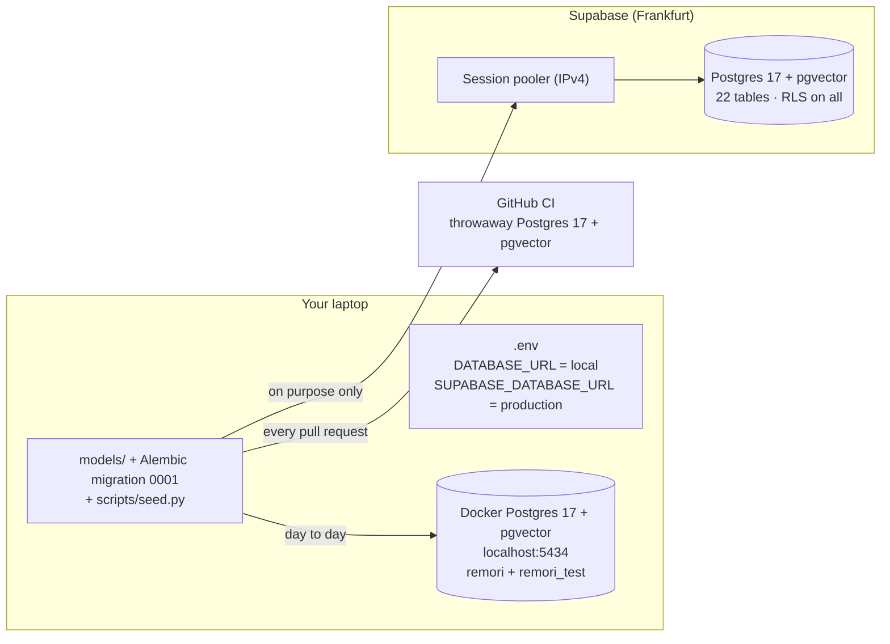

# Report: Phase 2, database live (M1)

What was built in Phase 2, why each piece exists, and how to use it. Companion to [REPORT_PHASE_0_1.md](REPORT_PHASE_0_1.md).

**Status:** Phase 2 done. Milestone **M1** reached: the full schema and seed data are live on Supabase and on local Docker. Work is in **PR #3** (CI green). Your remaining steps are at the end.

---

## 1. The big picture



One schema, defined once in Python (`app/models/`), turned into SQL by **one migration**, and applied to three places: your local Docker database, Supabase (production), and a temporary database in CI that tests it on every pull request.

---

## 2. Decisions taken in this phase (all yours)

| Decision | Choice | Why it mattered |
|---|---|---|
| Protecting Supabase | **RLS on + one policy per role** | RLS with *no* policies would also have blocked our own app user |
| Password hashing | **Argon2** (pwdlib) | Needed now, because the seed creates test accounts with passwords |
| Where secrets live | **One `backend-ai/.env`** (gitignored) | Local and production settings in one place, with a safety split (§8) |
| DB connections per API worker | **3 + 2 overflow** | 2 workers × 5 = max 10 connections to Supabase's free pooler |
| Code layout | **`models/` and `schemas/` folders by domain** | 22 tables is too many for one file |

---

## 3. The schema: 22 tables

### 3.1 Where each table lives (`app/models/`)
| File | Tables | What they hold |
|---|---|---|
| `accounts.py` | users, patient_profiles, caregiver_patient_links, refresh_tokens, push_tokens, devices | who can log in, who cares for whom, the glasses |
| `people.py` | enrolled_people, face_embeddings, unknown_face_clusters, encounters | the people the glasses recognize, and strangers |
| `places.py` | places | saved places for "Where am I?" |
| `journal.py` | events, audio_segments | the patient's day; audio waiting to be transcribed |
| `media.py` | media_assets, captured_documents | photos/videos (files in S3) and documents read from them |
| `reminders.py` | reminders, reminder_logs | the schedule and each occurrence |
| `activity.py` | mind_game_sessions, daily_summaries, caregiver_alerts | games, nightly summaries, alerts |
| `privacy.py` | consent_records, audit_log | consent, and who viewed or deleted what |

`app/models/__init__.py` re-exports all of them, so code imports `from app.models import User`. `app/schemas/` has the **same file names** and gets the API's request/response models from Phase 3 on.

### 3.2 The conventions, and why
| Convention | What it means | Why Remori needs it |
|---|---|---|
| **UUID primary keys, client may send its own** | e.g. the glasses create an encounter's ID offline | The phone can retry an upload safely: the same ID can't be inserted twice (idempotent sync, spec D21) |
| **`created_at` / `updated_at` / `deleted_at`** | `updated_at` changes itself on every update and is **indexed**. `deleted_at` marks a row deleted instead of removing it | The phone asks "what changed since 10:00?". Soft-deleted rows tell it what to remove locally |
| **`TIMESTAMPTZ`, always UTC** | timestamps carry a timezone | Egypt has daylight saving time. The app converts to Cairo time only for display |
| **20 Postgres ENUM types** | e.g. `user_role` = patient / caregiver, `event_type` = 11 values | The database itself rejects a typo like `"compelted"` |
| **Indexed foreign keys** | every "belongs to" column has an index | "All reminders of patient X" stays fast as data grows |
| **pgvector columns** | `VECTOR(512)` for faces, `VECTOR(1536)` for journal text | Stores AI embeddings next to the data (spec D14, D15) |
| **HNSW indexes** on the two searched vector columns | an index built for "find the most similar vectors" (cosine distance) | Face matching and RAG search stay fast without scanning every row |

### 3.3 Interpretations of the spec (where it was unclear)
| Spec | Done | Why |
|---|---|---|
| `users.phone` not marked optional | optional | The new-patient form (UI A4) has no phone field |
| column named `metadata` | DB column `metadata`, Python attribute `metadata_` | `metadata` is a reserved word inside SQLAlchemy models |
| lifecycle times (`deleted_at`, `read_at`, `revoked_at`, `last_seen_at`…) | optional | They stay empty until that event happens |
| tokens (`token_hash`, `fcm_token`) | unique | One token must belong to exactly one device or user |
| unspecified defaults | `Africa/Cairo`, memory capture on, statuses start at their first value | Matches the spec's lifecycles |

---

## 4. The migration (Alembic)

### 4.1 What a migration is
A **migration** is a versioned script that changes the database schema. Alembic records which version a database is at (table `alembic_version`), so `alembic upgrade head` on any database brings it to the latest version, and `alembic downgrade` undoes it. Same idea as the course (10:30–11:14).

Our `alembic/env.py` follows the course: the database comes from the **app settings** (`DATABASE_URL`), never from `alembic.ini`.

### 4.2 Problems in Alembic's autogenerated version, and the fixes
DATABASE.md says to **read every autogenerated migration**. This one had five problems:

| Problem | What would have happened | Fix |
|---|---|---|
| Used pgvector's column type without importing it | crash on the first run | added the import |
| **Reference loops**: `enrolled_people ↔ consent_records`, and `encounters → unknown_face_clusters → media_assets → events → encounters` | tables created in the wrong order (`encounters` before `users`), so the migration fails | one foreign key in each loop is added **after** all tables exist |
| pgvector extension not created | vector columns can't be created | `CREATE EXTENSION IF NOT EXISTS vector` runs first |
| No vector indexes | slow face and RAG search later | 2 HNSW indexes |
| Downgrade left enum types behind and couldn't drop looped tables | rollback fails | downgrade drops the loop keys first and all 20 enums last |

`alembic check` now confirms **the models and the migration match exactly**. If someone changes a model without writing a migration, a test fails.

---

## 5. Security: roles and Row Level Security

### 5.1 The problem being solved
Supabase gives every project a public **Data API**. Anyone with the project's public "anon" key could read tables through it unless something stops them. We don't use that API, but if it were switched on by mistake, family names, transcripts and photos would be exposed.

### 5.2 The solution in the migration
| Role | Who uses it | Can do |
|---|---|---|
| `postgres` (owner) | migrations and the seed | everything (owners bypass RLS) |
| **`remori_app`** | the FastAPI app + Celery workers (from Phase 4 on) | read and write rows, **no** schema changes |
| **`remori_readonly`** | teammates in pgAdmin | read only |
| Supabase `anon` / `authenticated` | the public Data API keys | **nothing** |

**Row Level Security (RLS)** makes Postgres check a *policy* for every row a role touches. A role with no matching policy sees zero rows, even if it has table permissions. The migration turns RLS on for **all 23 tables** (22 + Alembic's) and adds **44 policies** (2 per table): full access for `remori_app`, read for `remori_readonly`.

### 5.3 Verified on Supabase, logged in as each role
| Role | Result |
|---|---|
| `remori_app` | sees the 3 users ✅. Creating a table → **blocked** ✅ |
| `remori_readonly` | sees the 3 users ✅. Updating a row → **blocked** ✅ |
| `anon` / `authenticated` | see **0** users and 0 events ✅ |

⚠️ Supabase also has a **`service_role` key that bypasses RLS**. Remori never uses it. Keep it secret and never put it in the app.

---

## 6. Seed data (`scripts/seed.py`)

**What:** the UI board's sample day: Fatma (patient), caregivers Ahmed and Mona, 4 enrolled people with consent, device RMR-0007, 3 places, 3 reminders with today's occurrences, an encounter with Ahmed, a conversation, a question, a recording, a receipt and a medication label, an unknown face awaiting review, alerts, a daily summary, and game scores. 17 kinds of records in total. Full list: [SEED_DATA.md](SEED_DATA.md).

| Property | How | Why |
|---|---|---|
| **Fixed, readable IDs** | `0000000K-0000-4000-8000-00000000000N` (K = kind, N = number). Fatma = `00000001-…-000000000001` | Flutter mocks and the real API return the same records |
| **Idempotent** | every insert is "insert unless that ID already exists" | Running it twice changes nothing (tested) |
| **"Today" = today in Cairo** | times are built around the day the seed runs | The Today screens and journal have data. `--reset` (local only) moves "today" forward |
| **Safety guards** | refuses a non-local database without `--allow-remote`; never resets a non-local database; on Supabase demands `SEED_PASSWORD` and `SEED_DEVICE_TOKEN` | No accidental wipe of production, and no known default passwords in production |

Test logins: `ahmed@example.com` (manager) and `mona@example.com` (viewer). Password `remori-local` locally; on Supabase it's `SEED_PASSWORD` from `.env`.

Interpretations to remember: the device token is stored as a **SHA-256 hash** (Phase 3 confirms device-token hashing), and media rows have **placeholder file keys** (no real files in S3 until Phase 5).

---

## 7. Code and tools added

| File | Purpose |
|---|---|
| `app/models/` (9 files) | the 22 tables, by domain (§3.1) |
| `app/schemas/` (9 files) | empty, ready for Phase 3 |
| `app/utils.py` | course file: `hash_password` / `verify_password` with **Argon2** |
| `app/config.py`, `app/database.py` | + connection pool 3 + 2 |
| `alembic.ini`, `alembic/env.py`, `alembic/versions/0001_initial_schema.py` | migrations |
| `scripts/seed.py`, `docs/SEED_DATA.md` | seed + its reference |
| `requirements.txt` | + `pwdlib[argon2]`, + `tzdata` (timezone data missing on Windows and slim Docker images) |
| `tests/conftest.py`, `tests/test_database.py` | database tests (§9) |
| `.github/workflows/ci.yml` | CI gets a real Postgres |

---

## 8. The `.env` file

One gitignored file, `backend-ai/.env`, holds every setting. `.env.example` is the committed copy without secrets.

| Key | Purpose |
|---|---|
| `DATABASE_URL` | **local Docker** database: what the app, Alembic and the seed use by default |
| `SUPABASE_DATABASE_URL` | production, used **only on purpose** |
| `TEST_DATABASE_URL` | the separate `remori_test` database for pytest |
| `DB_POOL_SIZE`, `DB_MAX_OVERFLOW` | 3 and 2 |
| `REMORI_APP_DB_PASSWORD`, `REMORI_READONLY_DB_PASSWORD` | random login passwords of the two roles |
| `SEED_PASSWORD`, `SEED_DEVICE_TOKEN` | random test-account password and device token on Supabase |
| `AWS_REGION`, `S3_BUCKET` | for later phases |

**Why two database URLs:** if `DATABASE_URL` pointed at Supabase, every `alembic upgrade` or local run on your laptop would hit production. Production is only touched when a command explicitly swaps it in.

---

## 9. Tests and CI

`tests/conftest.py` (the course's idea) creates a **separate `remori_test` database**, so tests never touch your data. Without a database, those tests are skipped.

| # | Test | Proves |
|---|---|---|
| 1–2 | `/health` ok / database down | from Phase 1 |
| 3 | migration creates exactly 22 tables | schema complete |
| 4 | RLS on every table, 2 policies each | security can't silently disappear |
| 5 | both HNSW indexes exist | vector search ready |
| 6 | `alembic check` passes | models and migration never drift apart |
| 7 | seed runs, and a second run changes nothing | idempotent seed |
| 8 | downgrade leaves 0 tables, 0 enums | rollback works |

**CI** now starts a `pgvector/pgvector:pg17` container (as in the course's `build-deploy.yml`) and runs all 8. Verified in the CI log: **8 passed**.

---

## 10. How to use it

```bash
cd backend-ai
docker compose -f docker-compose.dev.yml up -d   # local Postgres (5434) + API (8000)

alembic upgrade head          # create / update the schema
python -m scripts.seed        # sample data
python -m scripts.seed --reset   # local only: wipe and reseed ("today" moves forward)
pytest -q                     # all checks
```

**pgAdmin connections**
| Database | Host | Port | User | Password |
|---|---|---|---|---|
| Local | `localhost` | 5434 | `remori` | `remori` |
| Supabase, read-only (teammates) | `aws-1-eu-central-1.pooler.supabase.com` | 5432 | `remori_readonly.enbmqwddwxkhkjihxdxn` | `REMORI_READONLY_DB_PASSWORD` from `.env`, SSL required |

---

## 11. Problems hit along the way (lessons)

| Problem | Lesson |
|---|---|
| Supabase's direct host is IPv6-only | always use the **session pooler** (Phase 0) |
| Alembic's table order broke on reference loops | read autogenerated migrations, break loops with "add this key later" |
| `alembic check` wanted to delete the vector indexes | indexes created in SQL must also be declared on the models |
| Multi-row insert failed when rows had different optional fields | the seed inserts row by row (fine for a small seed) |
| `zoneinfo` couldn't find `Africa/Cairo` on Windows | install `tzdata` |
| ruff 0.17 flagged broad `except` and unchecked `subprocess.run` | catch the specific error, state `check=False` explicitly |

---

## 12. What's next

| Step | Owner |
|---|---|
| Merge PR #3 | you |
| Share the read-only Supabase login with teammates (plan 2.7) | you |
| Rotate the Supabase owner password (still the one pasted in chat), then update `SUPABASE_DATABASE_URL` in `.env` | you |
| Turn off the Supabase Data API; rotate the AWS key | you |
| **Phase 3: auth + security core.** Register, login (Argon2), JWT access + refresh tokens, device pairing + device token, `require_patient_link`, error codes. Fills `schemas/accounts.py` | next |
| Decide: device-token hashing (SHA-256 like the seed, or something else) | you, in Phase 3 |
| In Phase 4: the deployed API connects as **`remori_app`**, not the owner | Phase 4 |
