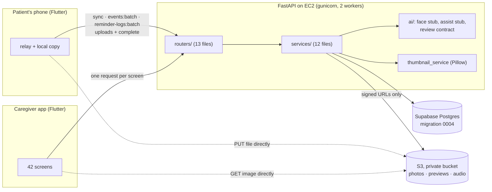
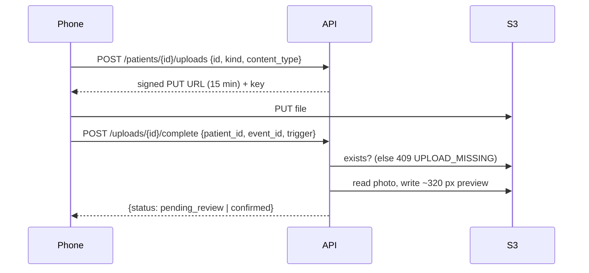

# Report: Phase 5, every endpoint the app needs (M3)

What was built in Phase 5, every decision, every bug found and fixed, every optimization, and how to deploy and check it. Companion to [REPORT_PHASE_0_1.md](REPORT_PHASE_0_1.md) and [REPORT_PHASE_2.md](REPORT_PHASE_2.md).

**Status:** Phase 5 built. **56 endpoints** (47 new) on the real database, with AI stubs where the models aren't ready. All 42 screens of the UI brief have their endpoints, except "Forgot password" (waits for the email decision). **79 tests pass**, ruff is clean, `alembic check` is clean. Supabase is already migrated to `0004`. The work is in **PR #8** (12 commits, ~5,300 lines). **Deploy: today** (§12).

---

## 1. The big picture



Phases 0–4 gave us infrastructure, the database, auth and a live server. Phase 5 adds **everything the app reads and writes**: people, faces, reminders, places, the journal, photos, documents, games, alerts. Files never pass through the API: the phone uploads straight to S3 with a short-lived signed link, and the app downloads straight from S3 the same way.

---

## 2. Decisions taken in this phase (all yours)

| # | Decision | Choice | Why it mattered |
|---|---|---|---|
| — | Mock repositories in Flutter | **Removed everywhere**; Flutter uses the live API | One source of truth; no mock/real drift |
| — | How "fake" Phase 5 is | **Real on the database + AI stubs** | CRUD is final code; only models wait |
| D27 | Endpoints the spec missed | `GET /auth/me`, `GET /patients`, people list/detail, single-photo removal, `rejected` in batches, pagination rule | Every app needs "who am I" and "my patients" on startup |
| D27 | Enrollment photos had no DB link | **`face_embeddings.storage_key`** (migration `0002`) | Photos listed from the DB, removable one by one |
| D27 | Archiving a person | Face data + photos deleted, consent revoked, row kept | Journal keeps the name; recognition stops (privacy) |
| D28 | Screens with no endpoint | Built all of them (§4.8) | Checked screen by screen against the UI brief |
| D28 | Slow screens (one request per item) | **Signed URLs inside list responses** | One request per screen instead of 10–20 |
| D28 | Thumbnails | **~320 px JPEG previews now** (migration `0004`), not in Phase 6 | Lists download ~30 KB instead of 2–4 MB per photo |
| — | C3–C7 vs. the designs | Dismiss deletes photos, 3 samples, per-photo errors, "enrolled by" | The designs promised these to users |
| D29 | AI output with no fixed shape | **Smart-review contract** + `other` fallback (§6) | Vision prompt, backend and app agree on one shape |
| — | Supabase migration | Run by me from your laptop, `0001 → 0004` | Additive columns: the old code on EC2 kept working |
| — | Deploy timing | First "with Phase 6", now **today** | §12 |

---

## 3. All 56 endpoints

**Who:** "any linked" = linked caregivers (manager or viewer) **and** the patient's phone · "manager" = managing caregiver only · "phone + manager" = the patient's phone or a manager · "caregivers" = linked caregivers, not the phone.

### 3.1 Accounts, patients, devices (9 existed, 7 new)
| Endpoint | Who | Screens | New |
|---|---|---|---|
| `POST /auth/register` · `login` · `refresh` · `logout` | anyone | A2, A3 | |
| `GET /auth/me` | caregiver | C18, startup | ✅ |
| `GET /patients` (with *your* permission per patient) | caregiver | C1 switcher | ✅ |
| `POST /patients` | caregiver | A4 | |
| `PATCH /patients/{id}` (profile + memory switch) | manager | C16, C18 | ✅ |
| `GET` · `POST /patients/{id}/caregivers` | caregivers · manager | C19 | GET ✅ |
| `GET /patients/{id}/consents` · `POST /consents/{id}/revoke` | caregivers · manager | C18 | ✅ |
| `POST /devices/pair` · `POST /devices/{id}/heartbeat` | manager · phone | A5 | |
| `GET /patients/{id}/devices` (with `online`) · `DELETE /devices/{id}` (unpair) | any linked · manager | C1, C16 | ✅ |

### 3.2 People and faces (11 new)
| Endpoint | Who | Screens |
|---|---|---|
| `GET /patients/{id}/people?status=active\|archived` (with `photo_url` preview) | any linked | C3 |
| `POST /patients/{id}/people` (multipart, 1–5 photos, consent) | manager | C4 |
| `GET /people/{id}` (photos + previews + `enrolled_by_name`) | any linked | C5 |
| `PATCH /people/{id}` · `DELETE /people/{id}` (archive) | manager | C5 |
| `POST /people/{id}/photos` · `DELETE /people/{id}/photos/{photo_id}` | manager | C5 |
| `GET /patients/{id}/unknown-faces` (up to 3 samples each) | caregivers | C6 |
| `POST /unknown-faces/{id}/promote` · `/dismiss` | manager | C7 |
| `GET /patients/{id}/sync?since=` (people + embeddings, reminders, places, settings) | any linked | phone |

### 3.3 Reminders and places (12 new)
| Endpoint | Who | Screens |
|---|---|---|
| `GET` · `POST` · `GET/{rid}` · `PATCH` · `DELETE /patients/{id}/reminders` | read any linked · write manager | C8, C9 |
| `POST /patients/{id}/reminder-logs:batch` | phone + manager | P2, P3 |
| `GET /patients/{id}/reminder-logs?date=` (with title) | any linked | C1, C8 Today |
| `GET` · `POST` · `GET/{pid}` · `PATCH` · `DELETE /patients/{id}/places` | read any linked · write manager | C10, C11 |

### 3.4 Journal, media, documents (9 new)
| Endpoint | Who | Screens |
|---|---|---|
| `POST /patients/{id}/events:batch` (encounters + events) | phone + manager | phone |
| `GET /patients/{id}/journal?date=` (people, photos + previews, documents) | any linked | C12, P4 |
| `POST /patients/{id}/uploads` → signed PUT · `POST /uploads/{id}/complete` | phone + manager (audio: phone) | phone |
| `GET /patients/{id}/media/{media_id}` (audit-logged, with event summary) | any linked | C13, P5 |
| `POST /media/{id}/pin` · `DELETE /media/{id}` | manager · phone + manager | C13, P5 |
| `GET /patients/{id}/documents?type=` · `GET /documents/{id}` | any linked | C14, C15 |

### 3.5 Activity and AI (8 new)
| Endpoint | Who | Screens |
|---|---|---|
| `POST` · `GET /patients/{id}/mind-game-sessions` | phone + manager · any linked | P7–P9 |
| `GET /patients/{id}/daily-summary?date=` | any linked | C17 |
| `POST /patients/{id}/assist` (**stub**) | any linked | P6 |
| `GET /caregivers/me/alerts` · `POST /alerts/{id}/read` | own alerts only | C1, C2 |
| `POST /me/push-token` | caregiver | startup |

The full request/response examples are in [`docs/API_CONTRACT.md`](../../docs/API_CONTRACT.md) §5.

---

## 4. How it works (the patterns used everywhere)

### 4.1 Layers (as in the course, plus `services/`)
`routers/` only read the request and check permission → `services/` hold the logic and the queries → `models/` + `schemas/`. Routers never touch the database directly; services never raise HTTP errors, only the app's own errors (`errors.py`), which become the spec §7.5 shape.

### 4.2 Permissions: "a record you can't access looks missing"
- Every `/patients/{id}/…` route depends on `require_patient_link`: a patient you aren't linked to returns **404 `PATIENT_NOT_FOUND`**, the same as one that doesn't exist (no ID guessing, "IDOR").
- Every `/{thing}/{id}` route (people, media, documents, consents, devices, unknown faces) uses `load_for_patient`: it loads the record, then checks access to *its* patient; no access → the thing's own `*_NOT_FOUND`.
- Writes use `require_editor`: a viewer gets **403 `MANAGER_ONLY`**, the phone gets **403 `CAREGIVER_ONLY`**, except where the phone is allowed to write (batches, uploads, games, deleting its own media).

### 4.3 Soft deletes + delta sync
Places, reminders and people are never hard-deleted: `deleted_at` is set. `/sync?since=T` returns everything with `updated_at >= T − 30 s` as **upserts** or **deletes**. The 30-second overlap exists because Postgres stamps rows with the *start* of their transaction; a write that commits right after a pull could otherwise be missed forever. Sending a row twice is harmless.

### 4.4 Idempotent batches (the phone may resend anything)
`events:batch` and `reminder-logs:batch` use ids generated on the phone/glasses. Every batch answers `{accepted, duplicates, rejected}`:
- **duplicates** = already stored (a resend after a lost response),
- **rejected** = points at something this patient doesn't have; the rest of the batch still goes in.

**Reminder merge rule** (spec §7.1): `completed` always wins; otherwise the newer `at` wins. A stale phone can never undo "taken".

### 4.5 Uploads (files never go through the API)

Keys are deterministic (`patients/{patient}/media/{id}.jpg`), so `complete` can be called twice safely. `user_requested` clips skip review and are kept forever (spec §7.4).

### 4.6 Audit log
Every signed photo URL handed out (single view, journal, documents, unknown-face samples) and every deletion writes an `audit_log` row, **in one bulk insert per request**. A phone acts on behalf of its patient.

### 4.7 AI stubs (same response shape as the real thing)
| Stub | File | Replaced in |
|---|---|---|
| `/assist` fixed answer (diacritized Arabic / English) | `ai/rag/answer.py` | 9.1 (Abdelrahman's RAG) |
| Enrollment face embedding: deterministic vector, `model_version = "stub-0"` | `ai/inference/face.py` | Phase 8 (real MobileFaceNet; re-embed every `stub-0` row) |
| Daily summaries, documents, unknown faces, review | written by worker jobs | Phases 6–9 (the endpoints already read them) |

**Consequence:** until Phase 8 the glasses can't recognise anyone from server embeddings, and "no face found" (C4) can't be detected.

### 4.8 Screen-by-screen audit (D28)
Every one of the 42 screens was mapped to its endpoints. Missing ones were built: device list + unpair (C1, C16), patient profile edit (C16, C18), today's reminder logs (C1, C8), caregivers list (C19), consents + revoke (C18), archived filter (C3), past games (P7), alert links (C2). The UI brief now names a real endpoint for every screen instead of a table name.

---

## 5. Optimizations

### 5.1 One request per screen
**Before:** lists returned ids only; the app would call `GET /media/{id}` once per photo.

| Network | One extra round trip | People grid (10) | Journal day (20 photos) |
|---|---|---|---|
| Good 4G / Wi-Fi | ~70–120 ms | +0.2–0.4 s | +0.3–0.6 s |
| Weak mobile signal | ~300–800 ms | +1–3 s | +2–5 s, some time out |

**After:** lists carry signed URLs (`photo_url`, `media[].url`, `thumbnail_url`, `samples[]`). Signing is a local computation (~0.2 ms, no call to AWS). With 20 caregivers opening the journal: **20 requests instead of ~420**, which matters with 2 workers.

### 5.2 Thumbnails (migration `0004`)
- A **~320 px JPEG** next to every photo, made at enrollment (bytes already in memory) and at upload completion (read back from S3, same region, ~0.1–0.3 s).
- A list image goes from **2–4 MB to ~30 KB**: the biggest win on mobile data.
- **EXIF (including GPS) stripped** from previews; sideways phone photos turned upright; a pixel limit refuses "decompression bomb" images.
- A failed preview never fails the upload: `thumbnail_url` is `null` and the app shows the full photo.
- Videos have no preview yet (needs ffmpeg, Phase 6).

### 5.3 Fewer database queries
| List | Before | After |
|---|---|---|
| People (C3) | 1 + 2 per person (count + photo) | **3 total** (grouped count, `DISTINCT ON` first photo) |
| Unknown faces (C6) | 1 + 1 per face | **2 total** (one join for all samples) |
| Journal (C12) | — | events + media + documents + people: **one query each** |
| Documents (C14) | 1 + photo lookup | **1** (document + photo + capture time in one join) |
| Audit rows | one insert per photo | **one bulk insert** per request |

### 5.4 Flutter caching rule (in the contract)
Signed URLs change on every response and expire after 10 minutes, so the app caches images **by the item's id**, not by URL (`CachedNetworkImage(cacheKey: id)`): each photo downloads once.

---

## 6. The smart-review contract (D29)

The problem: the spec left `extracted_fields` (documents) and `ai_tags` (photos) open-ended, so the vision prompt, the backend and the app would each guess a shape. Now [`app/ai/review_contract.py`](../app/ai/review_contract.py) defines it:

1. **Keep/discard is separate from category.** Category only decides the display; something important that fits nothing is still kept.
2. **Fixed shapes:** receipt `{merchant, total{amount, currency}, date, items[]}` · bill `{issuer, total, due_date, date}` · medication label `{medication_name, strength, instructions, expiry_date}` · `ai_tags {category, tags[], reason}`.
3. **Everything else is `other`** with the model's own `title` and `{label, value}` rows (in the patient's language) or `reason`. The app has one generic layout for it.
4. **An unexpected answer never fails a job.** Unknown category → `other` + `raw_category`. Key variants are matched (`amount` → `total`, `dosage` → `strength`); this also made the old seed rows display correctly without rewriting them.
5. **Categories grow only through you:** `AI_LAYER.md` §4 has the SQL that counts what the model keeps inventing.
6. **Ready to show:** documents return `title`, `headline` ("120 EGP", "Concor 5 mg"), ordered `fields` with a translatable `key`, and `captured_at` (the glasses' time, not the server's). Photos return their event (type, time, person) for C13.

---

## 7. Bugs and gaps found and fixed

| Found | Problem | Fix |
|---|---|---|
| Writing people endpoints | `async` routes would have run blocking DB + S3 calls on the event loop, freezing the worker | All routes sync; uploads read through `photo.file` |
| Sync design | A write committing just after a pull could be missed forever (transaction-start timestamps) | 30-second overlap window (§4.3) |
| Screen audit | 9 screens (C1, C2, C3, C8, C16, C18, C19, P7, A2) were missing an endpoint; the brief pointed them at tables | D28 endpoints (§4.8) |
| Speed review | One request per photo; per-person queries in my own people list | §5 |
| Unpair | Devices can't be deleted (events point at them) | `unpaired_at` (migration `0003`): token dies at once, row kept, glasses re-pairable to any patient |
| Consent revoke | Revoking face consent without stopping recognition would be a privacy hole | Revoking face enrollment archives the person (face data deleted) |
| C7 vs. spec | **Dismissing a stranger did not delete their photos** (spec retention rule, and the screen promises it) | Dismiss deletes every photo of the face + previews, audit-logged |
| C7 design | One sample photo; the design shows three | `samples[]`, up to 3, chosen sample first |
| C4 design | Errors didn't say which photo failed, and stopped at the first | `details: [{field: "body.photos.2"}]` for **every** bad photo |
| C5 design | "Enrolled by Ahmed Mostafa" not returned | `enrolled_by_name` |
| Enrollment | Files that only *look* like JPEG/PNG were accepted | Pillow must be able to open them |
| C13–C15 | No title, headline, row order or capture time; `created_at` was the server's time | §6 |
| Tests | An earlier edit had **silently not applied**: single-photo removal was never tested | Test added; all later edits assert that they applied |
| Tests | Journal photos passed raw AI tags through un-normalized | Normalization moved into the `AiTags` model itself, so every response is covered |
| Edge case | Empty `{}` AI tags would have failed the whole response | Treated as "no tags" |

---

## 8. Database changes (all applied to Supabase)

| Migration | Adds | Why |
|---|---|---|
| `0002` | `face_embeddings.storage_key` | Each enrollment photo listed and removable from the DB |
| `0003` | `devices.unpaired_at`, `caregiver_alerts.entity_type` / `entity_id` | Unpair without losing history; tapping an alert opens its item (C2) |
| `0004` | `media_assets.thumbnail_key`, `face_embeddings.thumbnail_key` | Previews |

All columns are **nullable additions**, so they were applied to Supabase **before** the code deploy without affecting the running server (checked: `/health` and login stayed fine). I ran them from your laptop with the owner URL from `.env`, never printed. `alembic check` on Supabase: *No new upgrade operations detected*. Google/Facebook sign-in moves to migration `0005`.

---

## 9. Code added

| Area | Files |
|---|---|
| Routers (new) | `people`, `reminders`, `places`, `sync`, `journal`, `media`, `activity`, `assist`, `consents` |
| Services (new) | `people_service`, `reminder_service`, `place_service`, `sync_service`, `journal_service`, `media_service`, `document_service`, `activity_service`, `thumbnail_service` |
| AI | `ai/inference/face.py` (stub), `ai/rag/answer.py` (stub), `ai/review_contract.py` (D29) |
| Integrations | `integrations/s3.py`: presign PUT/GET, put, get (size-capped), exists, delete, list; boto errors → `503 STORAGE_UNAVAILABLE` |
| Shared | `oauth2.py`: `require_editor`, `load_for_patient`, unpaired tokens rejected · `errors.py`: `InvalidInput`, `StorageUnavailable`, per-field `details` · `schemas/common.py`: `BatchResult` |
| Dependencies | `python-dateutil` (RRULE validation), `pillow` 12.3.0 (previews) |
| Seed | Canonical document shapes (D29) |

---

## 10. Tests

**79 tests** (49 new in this phase), run against a real Postgres + pgvector, with an **in-memory fake S3** so no test ever reaches AWS.

| File | Covers |
|---|---|
| `test_places_reminders.py` | CRUD, soft delete, RRULE + timezone validation, merge rule, idempotency, foreign reminders rejected, viewer/phone permissions |
| `test_people_sync.py` | Enrollment, photos, per-person IDOR, sync with float16 embeddings, archive → sync delete, promote |
| `test_journal_media.py` | Batches (idempotent, rejected), journal by local day, upload flow, `UPLOAD_MISSING`, pin, delete, audit rows, user-requested clips, audio phone-only, real 4000×3000 photo → 320 px preview without EXIF, broken image still uploads |
| `test_activity.py` | Games (+ journal), summary 404/200, alerts private, push token moves between caregivers, `/assist` stub language |
| `test_screen_gaps.py` | PATCH patient → sync, caregivers, devices + unpair + re-pair elsewhere, consent revoke archives, photo URLs, today's reminder logs, games list |
| `test_c3_c7_fixes.py` | Every bad photo named, enrolled-by, 3 samples, dismiss deletes photos |
| `test_review_contract.py` | Key variants, money parsing, invented categories → `other`, garbage never raises, screens show title/headline/fields |

Also checked for real: the Docker image builds and starts with Pillow, every new endpoint answers over HTTP on the local server, and the seeded old-format rows display correctly.

---

## 11. Docs updated

[`REMORI_SPEC.md`](../../REMORI_SPEC.md) (D27, D28, D29, §6 columns, §7.2 endpoints, pagination, §7.4 review contract) · [`docs/API_CONTRACT.md`](../../docs/API_CONTRACT.md) (every endpoint, error codes, image caching, document rows) · [`flutter/AGENTS.md`](../../flutter/AGENTS.md) §1.1 (real endpoints per screen; the UI brief was replaced by the UI board) · [`docs/diagrams/02-database-erd.md`](../../docs/diagrams/02-database-erd.md) · [`AI_LAYER.md`](AI_LAYER.md) (stubs, review contract) · [`DEVELOPMENT_PLAN.md`](DEVELOPMENT_PLAN.md) + `.html` · [`../AGENTS.md`](../AGENTS.md) · [`../../flutter/AGENTS.md`](../../flutter/AGENTS.md) · [`../../AGENTS.md`](../../AGENTS.md).

---

## 12. Deploying today

**1. Before deploying, check the EC2 server's IAM role.** It must allow, on `remori-media-090413359449`:
- `s3:PutObject`, `s3:GetObject`, `s3:DeleteObject` on `patients/*` (GetObject also covers the "does it exist" check and reading photos for previews),
- `s3:ListBucket` on the bucket (photo cleanup when archiving).
Without them: uploads fail with `503 STORAGE_UNAVAILABLE`, and previews are silently skipped.

**2. Merge, then deploy** (the database is already at `0004`, nothing to migrate):
```bash
# GitHub: merge PR #7, then PR #8 (CI green)
ssh -i ~/.ssh/remori-ec2.pem ubuntu@remori-ai.duckdns.org
cd ~/remori && git checkout main && git pull
cd backend-ai && docker compose up -d --build     # --build: new packages (dateutil, Pillow)
docker compose logs --tail 50 api                  # no tracebacks
```

**3. Smoke test** (as `ahmed@example.com`, patient `00000001-0000-4000-8000-000000000001`):

| Check | Expect |
|---|---|
| `/docs` | sections People, Reminders, Places, Sync, Journal, Media, Activity, Assist |
| `GET /auth/me`, `GET /patients` | 200, Fatma with `permission: manager` |
| `GET …/sync` | settings + people + reminders + places |
| `GET …/journal?date=` a seeded day (`2026-10-09`…`12`) | entries with `media[].url` (proves S3 signing works) |
| `GET …/documents` | receipt with `headline: "120 EGP"`, label with `"Concor 5 mg"` |
| `POST …/people` with one real JPEG | 201; then `GET /people/{id}` has a `thumbnail_url` (**first real S3 write + read**) |
| `GET …/devices` | RMR-0007 with `online` |
| `POST …/assist` | the fixed Arabic answer |

**4. After the deploy:** the status lines in the docs say "Phase 5 deploys with Phase 6"; tell me once it's live and I'll update them.

---

## 13. Lessons

- **Check the designs, not just the spec.** The spec's endpoint list missed 9 screens and the C7 photo deletion; only mapping screen by screen found them.
- **Count requests per screen, not per endpoint.** A correct endpoint can still make a screen slow.
- **Never let an AI answer break a job.** Normalize, keep the raw value, review later.
- **Tests must prove the edit landed.** One silent no-op edit hid an untested path for a day.
- **Additive migrations can go first.** Nullable columns let the database change before the code, with zero downtime.
- **Local Docker can't sign S3 URLs** (no AWS credentials). Fine after today's deploy; if anyone needs full photo flows on a laptop later, add MinIO to `docker-compose.dev.yml`.

---

## 14. What's next

| Item | When |
|---|---|
| Phase 6: Celery + Redis; move upload previews into a task; video previews (ffmpeg); alerts and retention jobs fill C2 and the "auto-deletes in N days" badges | next |
| Phase 7: smart review + OCR (vision prompt follows D29) → documents and AI tags become real | after 6 |
| Phase 8: real face model; re-embed `stub-0` rows; "no face found" (C4) | after 7 |
| Phase 9: real `/assist` (Abdelrahman) and daily summaries | after 8 |
| Your decisions: email verification + "Forgot password" (needs AWS SES), Google/Facebook timing | open |
| Your actions: rotate the AWS key and Supabase owner password shared in chat; turn off the Supabase Data API | open |
