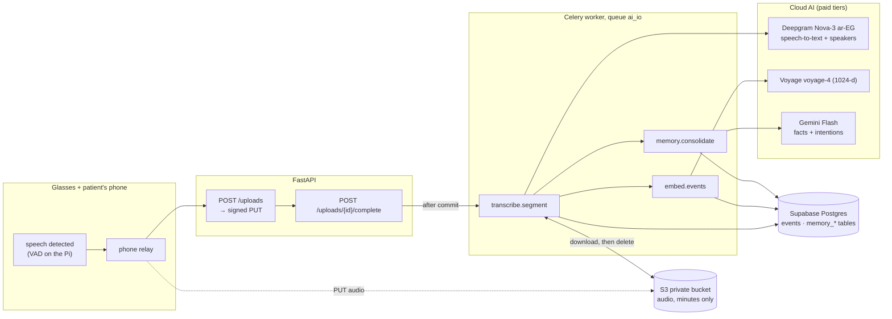
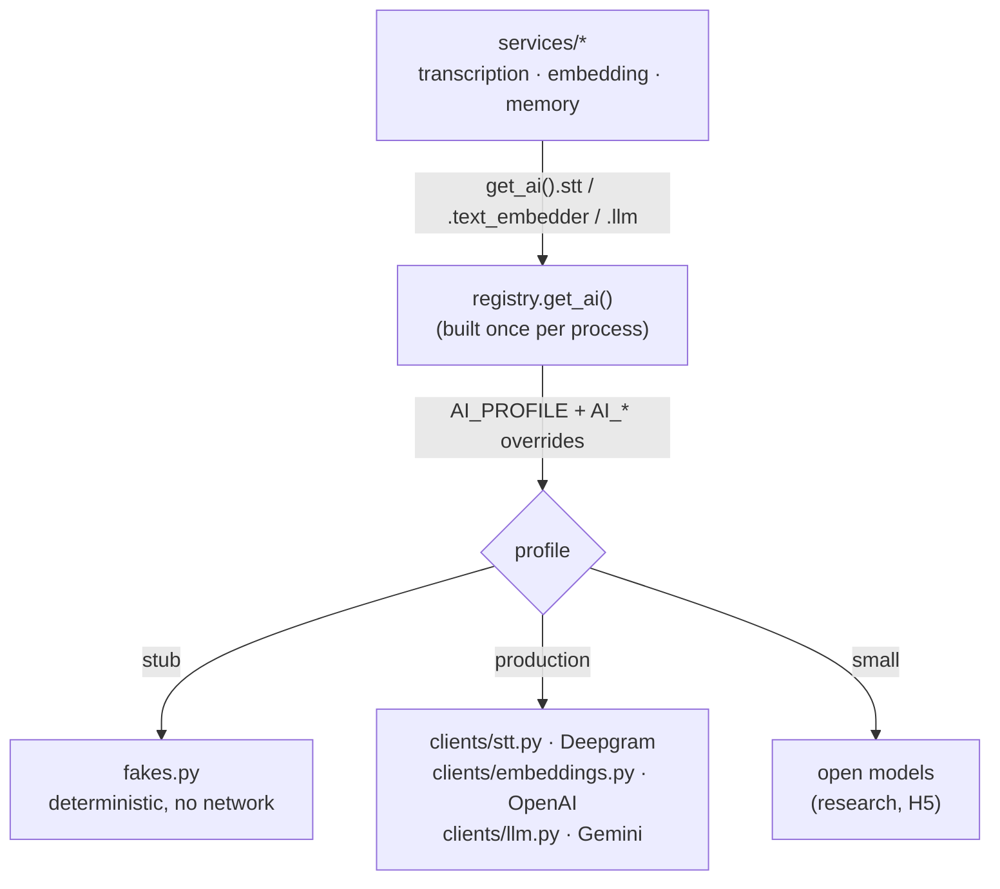
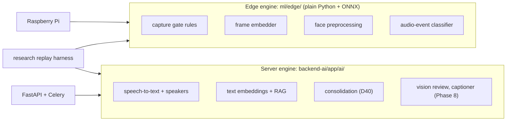
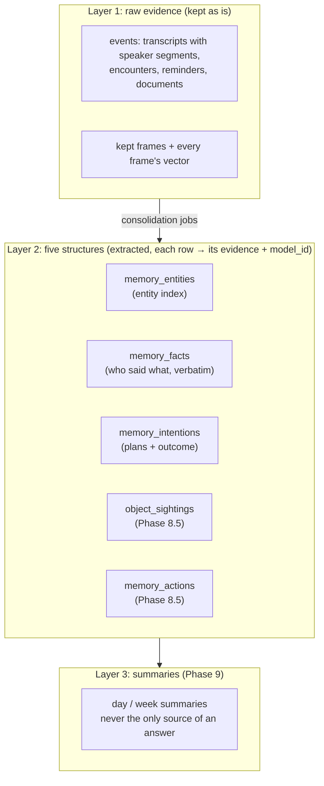
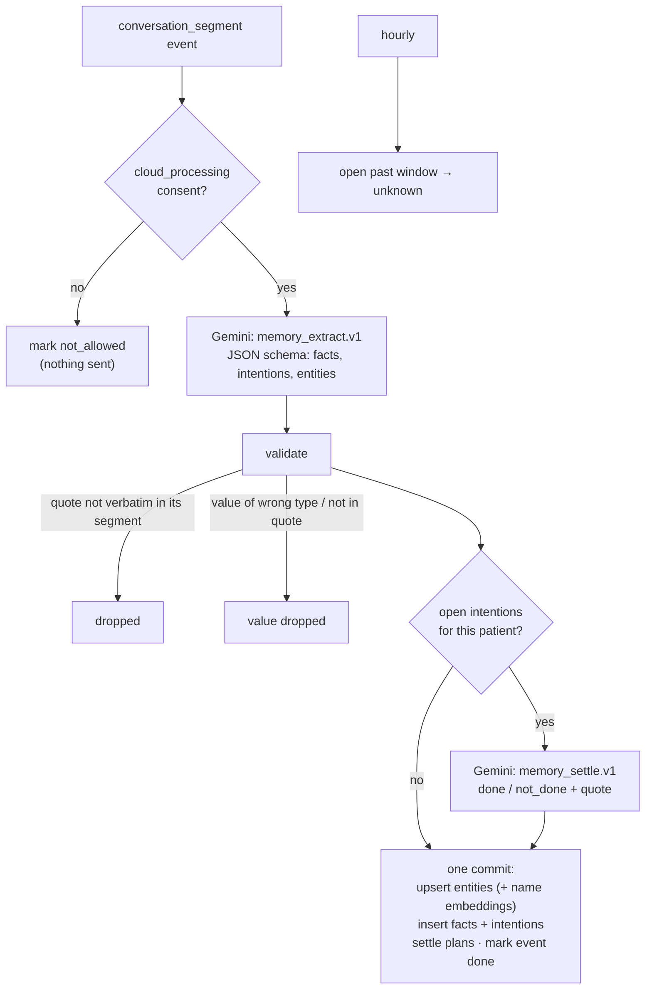

# Report: Phase 7, the ambient memory pipeline (M5)

What was built in Phase 7, the architecture behind it, every decision, every bug found and fixed, the measurements, how we worked, and how to take it live. Companion to [REPORT_PHASE_0_1.md](REPORT_PHASE_0_1.md), [REPORT_PHASE_2.md](REPORT_PHASE_2.md) and [REPORT_PHASE_5.md](REPORT_PHASE_5.md).

**Status (26 Oct 2026):** Phase 7 is complete in code. A recording uploaded by the patient's phone becomes a speaker-labelled transcript in the journal, gets a searchable sentence and embedding, has its facts and plans extracted, and its audio is deleted. **236 tests pass**, ruff is clean, `alembic check` is clean (migration `0006`). Work merged in **PRs #65–#77**, plus the Voyage switch (embeddings 1024-d). **Not live yet:** the server still runs the `stub` profile until the provider keys are set (§11).

---

## 1. What Phase 7 delivers, in one picture



Before Phase 7, the backend stored what the app sent but understood none of it. After Phase 7, **speech turns into memory**: what was said, by which voice, who was in the room, which numbers and appointments were mentioned, and which plans were made and later kept or forgotten. That is the M5 milestone.

---

## 2. Steps and pull requests

| Step | What | PR |
|---|---|---|
| Research plan | The paper track (D32), the benchmark, hypotheses H1–H6, decisions D32–D40 | #66 |
| **7.0** Model interfaces | One interface per AI capability, fakes, profiles `production` / `small` / `stub` (D37, D38) | #67 |
| Engine split | Edge engine (`ml/edge/`) vs server engine (`backend-ai/app/ai/`), one copy each (D38) | #68 |
| **7.0b** Memory contract | Spec §6/§7.1/§8 for scene segments, frame vectors, `gate_rule`, sounds, the five memory tables (D41) | #69 |
| Model choice | [MODELS_CHOICE.md](MODELS_CHOICE.md): cloud options, free tiers, data-use rules, measured speech-to-text | #70 |
| **7.1** Speech-to-text | Deepgram Nova-3 `ar-EG` client with speaker labels, chosen by measurement | #71 |
| R2 renderer | `ai/rag/render.py`: one sentence per event (Abdelrahman's track R2) | #65 |
| Plan sync | `DEVELOPMENT_PLAN.html` kept identical to the Markdown | #72 |
| **7.2** Task `transcribe` | Audio → volume boost → transcript event → audio deleted | #73 |
| **7.3** Task `embed` | Every event → sentence → embedding for RAG | #74 |
| **7.4** Wire it | Uploads start the transcription; the safety sweep | #75 |
| **7.5** Consolidation | Facts, intentions, entity index from speech with Gemini Flash | 7.5 PR |

---

## 3. Decisions taken in this phase

| # | Decision | Choice | Why it matters |
|---|---|---|---|
| D32 | Research track | A paper runs alongside the build: gated memory vs store-everything on ~200–250 planted questions (Egyptian Arabic + English) | Gives the project a measurable claim, not just a demo |
| D33 | Capture gate v1 | Face, text, medication, novelty rules + a learned classifier + audio-event triggers; every kept item records its `gate_rule` | Explainable selection; ablation per rule (H4) |
| D34 | Frame embeddings | The glasses embed **every** 1 fps frame and send only the vector | "Was I in the kitchen at 3?" works even for frames that weren't kept |
| D35 | Unknown faces | Raw samples only inside the review cluster, max 30 days; blurred elsewhere | Privacy of people who never consented |
| D36 | Who said what | Speaker labels from diarization + `present_person_ids` from faces; no voice enrollment | "What did Ahmed say?" without recording anyone's voiceprint |
| D37 | Models | Product = cloud APIs; the engine picks models from configuration so the paper can compare cloud vs small open models | One code path for product and research (H5) |
| D38 | Packaging | **Edge engine** in `ml/edge/` (Pi, replay harness, enrollment embedder) and **server engine** in `backend-ai/app/ai/`, one copy each | No drift between what the glasses run and what we evaluate |
| D39 | Answering with evidence | Plan → up to 3 searches → evidence + premise check → answer with sources, or a kind "I'm not sure" | Fewer confident wrong answers (H3) |
| D40 | Structured memory | Three layers: raw evidence → **five structures** → summaries | Counting, intentions and false-premise questions need structure, not just similarity (H6) |
| D41 | Memory contract | Two-tier frame memory, `gate_rule`, `sound_detected`, speaker segments, five tables, 90-day retention for segments and vector files | Agreed with hardware + Flutter **before** any ingestion code |
| — | Speech-to-text provider | **Deepgram Nova-3 `ar-EG`**, measured (§8) | Best words on every test, fastest |
| — | Quiet voices | **Boost the volume** before transcribing (`dynaudnorm` + `loudnorm`) | Recovered ~20 % more speech on our recording |
| — | Consent gate | Without master switch + household audio + cloud consents, audio is **deleted untranscribed** (spec §7.3) | Nothing reaches a provider without permission |
| — | Embeddings | Voyage `voyage-4`, 1024-d (D15 changed from OpenAI 1536-d; migration 0006) | Free allowance, multilingual; OpenAI has no free tier |
| — | LLM measured | Gemini Flash beats Qwen3.8 and GPT-OSS on our extraction test (MODELS_CHOICE §7.5) | Every plan found, every holder right |
| — | LLM | **Gemini Flash, paid tier** (7.5) | Strong Arabic, JSON-schema output; the free tier may use prompts, which are patients' conversations |
| — | 7.5 scope | Only the tables 7.5 fills: `memory_entities`, `memory_facts`, `memory_intentions` | Objects and actions come with vision (8.5), scene segments with glasses ingestion |

---

## 4. Architecture 1: the AI layer (interfaces, profiles, providers)

Every AI capability is an **interface** (a Python `Protocol` in `app/ai/interfaces.py`). Services never import a provider; they call `get_ai().<capability>`. Which class answers is decided by configuration.



| Capability | Interface | `production` | `stub` (tests, local) |
|---|---|---|---|
| `stt` | `transcribe(audio, content_type, language_hint) → Transcript` | Deepgram Nova-3 `ar-EG` + diarization | fixed Arabic sentence |
| `text_embedder` | `embed(texts) → vectors` | Voyage `voyage-4` (1024-d) | hash-seeded unit vectors |
| `llm` | `complete(messages, json_schema) → text` | Gemini Flash (`gemini-3.8-flash`) | `{}` / "fake answer" |
| `vision`, `captioner` | review / caption | Phase 8 | fakes |
| `face` | `embed(image) → 512-d` | MobileFaceNet (Phase 8) | the enrollment stub |

**Rules every client follows** (AI_LAYER.md):
- A timeout, 429 or 5xx raises `TransientError`: Celery retries with backoff and jitter. A 4xx raises the client's permanent error and is **not** retried.
- Keys come from settings. A missing key fails at start with `ProviderNotAvailable` naming the variable.
- Nothing logs prompts, transcripts, quotes or names.
- Tests never call a real API: clients are tested with `respx` (mocked HTTP), services with fakes.

Switching a single capability: `AI_LLM=fake` keeps the rest of `production`. The research harness switches whole profiles.

---

## 5. Architecture 2: the edge engine and the server engine (D38)



One copy of each part. The glasses and the research replay run **the same** edge code, and the backend and the research run **the same** server code. So the numbers in the paper describe the product, not a re-implementation.

---

## 6. Architecture 3: the memory model (D40, D41)

### 6.1 Three layers



| Question type | Answered from |
|---|---|
| "What did the doctor say the dose was?" | `memory_facts` (quote + typed value `5 mg`) |
| "Did I call Ahmed yesterday?" | `memory_intentions` (status + the evidence that settled it) |
| "Where did I put my glasses?" | `object_sightings` (8.5) + frame vectors |
| "Did Sara visit today?" (she didn't) | `memory_entities` premise check: never seen today → say so |
| Anything else | vector search over event sentences (7.3) |

### 6.2 Two-tier frame memory (D41)

The glasses see one frame per second. Storing every frame's vector in Postgres would grow the database by ~30 MB per patient per day. Storing one vector per scene would lose detail. The contract splits it:

| Tier | Where | What | Size |
|---|---|---|---|
| 1 | Postgres (`scene_segments`, `scene_vectors`) | runs of similar frames (≤ 30 s) with **3 real frame vectors** each: first, middle, most different | ~6 MB/day |
| 2 | S3 (`frame_vector_files`) | **every** frame's vector, one 8-bit file per hour | ~30 MB/day |

Search is two-stage: tier 1 finds the candidate minutes, then tier 2 re-ranks every second inside them. Both tiers are kept 90 days. These tables are specified but **not built yet**: they arrive with the glasses ingestion.

---

## 7. The pipeline, step by step (workflows)

### 7.1 From upload to memory

```mermaid
sequenceDiagram
    participant P as Phone
    participant A as API
    participant S as S3
    participant T as transcribe.segment
    participant E as embed.events
    participant M as memory.consolidate
    P->>A: POST /patients/{id}/uploads {kind: audio}
    A-->>P: signed PUT URL
    P->>S: PUT audio
    P->>A: POST /uploads/{id}/complete
    A->>A: commit audio_segments row (uploaded)
    A-)T: enqueue (after commit; never fails the upload)
    T->>T: consent check (master switch + household + cloud)
    alt not allowed
        T->>S: delete audio, untranscribed
    else allowed
        T->>S: download
        T->>T: ffmpeg volume boost → 16 kHz mono WAV
        T->>T: Deepgram → text + speaker segments
        T->>T: write conversation_segment event<br/>(segments, present_person_ids)
        T->>S: delete audio (spec D4)
        T-)E: enqueue
        T-)M: enqueue
        E->>E: render sentence → embed → store
        M->>M: extract facts / intentions / entities<br/>settle open intentions → store
    end
```

### 7.2 What each task guarantees

| Task | Queue | Trigger | Idempotent because | If it keeps failing |
|---|---|---|---|---|
| `transcribe.segment` | `ai_io` | upload complete | event id = uuid5(segment id); `transcribed` / `deleted` segments are skipped | 3 retries → `failed`; retention deletes the audio at 7 days |
| `transcribe.backfill` | `ai_io` | Beat, every 10 min | re-queues only stuck segments (`uploaded` > 2 min, `transcribing` > 30 min) | — |
| `embed.events` | `ai_io` | after a transcript | only events without an embedding | 3 retries; the backfill picks it up |
| `embed.backfill` | `ai_io` | Beat, every 5 min | same; one sweep at a time (lock) | — |
| `memory.consolidate` | `ai_io` | after a transcript | `events.metadata.memory` is written in the **same commit** as the rows | 3 retries; a permanent failure is marked `failed` |
| `memory.backfill` | `ai_io` | Beat, every 10 min | only events without `metadata.memory` | — |
| `memory.expire_intentions` | `ai_io` | Beat, hourly | an update on `open` rows only | — |

If Redis is down at upload time, nothing is lost: the upload still succeeds, and the backfill sweeps pick the work up within 10 minutes.

### 7.3 Consolidation in detail (7.5)



**What protects quality:**
- **Verbatim quotes.** Every fact, intention and settlement must name a segment, and its quote must appear in that segment word for word (only whitespace may differ). A paraphrase is dropped, so the system never puts words in someone's mouth.
- **Typed values.** `money` / `dose` / `number` must be numbers, `date` an ISO date, `time` HH:MM, and the value's own words must be inside the quote. Relative dates ("بكره", "Thursday") are resolved by the model from the local date we send. Due times are read in the patient's timezone and stored in UTC.
- **Entity index.** Names are normalized (whitespace, case). The upsert is race-safe: `INSERT … ON CONFLICT DO UPDATE`, counting one mention per conversation. A person entity links to an enrolled person when the name matches exactly one (first name or full name), and a place entity to a saved place. New names are embedded so "my glasses" can match "النضارة".
- **Speakers.** Diarization says *which voice*, not *who*. When exactly one enrolled person was present (from faces) and the model says the speaker is not the patient, the fact is attributed to that person. Otherwise the speaker stays a label.
- **Intention lifecycle.** `open` → `done` / `not_done` (with the quote and the event that settled it) → or `unknown` after its window: `due_until`, else `due_at` + 1 day, else 7 days after it was said.
- **Provenance.** Every row stores `model_id` = model + prompt version (e.g. `gemini-3.8-flash/memory_extract.v1`), so a better prompt can be compared against the old one (research H5/H6).

### 7.4 Privacy along the pipeline

| Point | Rule |
|---|---|
| Before transcription | Master switch + household audio + cloud consents, or the audio is deleted untranscribed |
| After transcription | Audio deleted from S3 at once; only text is kept (D4) |
| Before the LLM | `cloud_processing` consent, or nothing is sent |
| Providers | Paid tiers only for real data (no training on our data) |
| Logs | Ids and counts only: never transcripts, quotes, names or vectors |
| Keys | `.env` locally and the server's env file; never in git or chat |

---

## 8. Measurements: choosing speech-to-text

Full method and caveats: [MODELS_CHOICE.md](MODELS_CHOICE.md) §7 (script `ml/rag_eval/stt_quick_check.py`, 20 clips per dataset).

| Dataset | Deepgram Nova-3 `ar-EG` | AssemblyAI Universal `ar` |
|---|---|---|
| MGB-3 Egyptian (spontaneous TV / YouTube speech) | **WER 32.7 %** · CER 19.5 % | WER 41.1 % · CER 22.7 % |
| FLEURS `ar_eg` (read speech) | **WER 4.6 %** · CER 1.0 % | WER 9.0 % · CER 2.7 % |

On our own two-person voice note, the volume boost recovered about 20 % more speech. **Speaker separation is still open:** Deepgram put both voices under one label. The candidate fix is pyannote matched to Deepgram's word timestamps, helped by faces and by the wearer's voice being the loudest.

---

## 9. How we worked

### 9.1 Contract first
Nothing that crosses an area boundary was coded before its contract was in the spec: the memory tables, the frame-vector message and the retention rules went into spec §6/§7.1/§8 (7.0b, D41) and were agreed with hardware and Flutter before any ingestion code.

### 9.2 Branches, PRs, CI
- One branch and one PR per step; never a push to `main`.
- **Stacked PRs:** when a step needed an unmerged one (7.2 needed the R2 renderer from #65), the dependency branch was merged into the feature branch and the **merge order** was written down, then the PRs were merged in that order.
- **CI gate:** merge only when the pull-request run **on the head commit** has finished green. The wait script was rewritten after #65 (below) to watch `gh run list --commit HEAD --event pull_request` until it completes with success.
- Commits under the lead's name only.

### 9.3 Tests against a real database
Every service test runs against a local Postgres with pgvector (`docker-compose.dev.yml`, port 5434, database `remori_test`), migrated with `alembic upgrade head` at session start. Celery tasks run inline (`task_always_eager`), S3 is in memory, and AI calls use fakes or `respx`. The test database is shared across runs, so tests never assume a global count.

| Step | New tests | Suite after |
|---|---|---|
| 7.0–7.4 | interfaces, registry, Deepgram client, transcription, render, embeddings, wiring | 210 |
| 7.5 | Gemini client (5), validation (4), consolidation + tasks (8), schema count | **229** |

---

## 10. Bugs and mistakes (and what they taught us)

| What happened | Cause | Fix | Lesson |
|---|---|---|---|
| FK violation writing the transcript (7.2) | `audio_segments.event_id` set before the event row was flushed; no ORM relationship orders the two inserts | `db.flush()` after adding the event | Real-database tests catch what mocks can't |
| Backfill test failed on a second run (7.3) | Assumed the test DB was empty | `>=` counts + per-row checks | Shared DBs: assert on your own rows |
| "09:20" rendered as "08:20" (7.3) | Cairo is UTC+3 in summer (DST) | Test clock fixed; services always convert with `ZoneInfo` | Never hard-code offsets |
| Eager retry raised `Retry` instead of the error (7.2, 7.5) | Celery eager mode with `autoretry_for` | Test the service directly for transient errors | Test the layer that owns the behaviour |
| `#65` merged before its CI run finished | The wait script treated "no checks yet" as "all passed" | Script rewritten to wait for the head commit's run to complete; CI later passed | A gate must fail closed |
| `#66` merged before the last commit landed | Merge raced the push | The commit was cherry-picked into #68 | Check the head commit before merging |
| Broken `try_stt.py` commit | A write was rejected and the commit went out with an import of a removed client | Fixed and verified with a real run | Run the script after every edit, not just lint |
| Migration 0005 autogenerate | Would recreate the existing `transcript_language` enum, missed RLS/grants and enum drops | Hand-fixed (`create_type=False`, grants + policies loop, drops in downgrade); verified up → down → up + `alembic check` | Always read the autogenerated migration (DATABASE.md §3) |

---

## 11. Going live (your actions)

1. **Keys** (never in chat or git): in `backend-ai/.env` locally and in the server's env file:
   `DEEPGRAM_API_KEY`, `VOYAGE_API_KEY` (**opt out of training** in the Voyage dashboard), `GEMINI_API_KEY` (paid key, so Google's paid terms apply).
2. **Models:** either `AI_PROFILE=production` with `AI_CAPTIONER=fake` (no captioner yet), or keep `stub` and set `AI_STT=deepgram-nova-3`, `AI_TEXT_EMBEDDER=voyage-4`, `AI_LLM=gemini-flash`, `AI_FACE=mobilefacenet-onnx`, `AI_VISION=gemini-flash` (photo review, phase 8.3). With the real face model, run `faces.reembed_stub` once after the redeploy (phase 8.2): `docker compose exec worker celery -A app.workers.celery_app call faces.reembed_stub`.
3. **Migrate Supabase** to `0006` (`alembic upgrade head` as `postgres`). `0005` adds tables; `0006` resizes the text vectors to 1024 and clears the old ones, so deploy the new code right after it.
4. **Redeploy** `api`, `worker` and `beat` (all three read the env; Beat has the new schedule).
5. **Check:** upload a short recording from the test patient (with all consents), then within a minute the journal shows the transcript, and `memory_facts` / `memory_intentions` have rows linked to that event.

---

## 12. What's next

| Next | Why |
|---|---|
| Deploy with keys (§11) | M5 live, real data flowing |
| Speaker separation (pyannote + timestamps) | Facts attributed to the right person when several are present |
| Measure extraction quality on our own recordings | Precision of facts / intentions before relying on them in answers |
| Phase 8: vision review, captioner, faces; 8.5 object sightings + action log | The other two structures (D40) |
| Glasses ingestion: scene segments + frame-vector files (D41) | Two-tier frame memory |
| Phase 9: answering with evidence (D39), summaries | Use the structures to answer questions, with sources |
| Event deletion → structures | Spec §8: deleting an event must delete the structure rows whose only evidence it was. No endpoint deletes events today; it comes with the first one |
