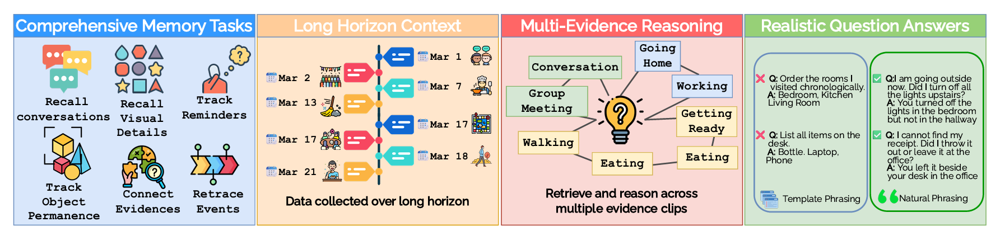

# Remori Research Plan: gated memory for Alzheimer's memory assistance

**What this is:** the plan for the research paper and its experiments, run in parallel with building the product. The **decisions** it relies on are in [`REMORI_SPEC.md`](../REMORI_SPEC.md) §0 as **D32–D39**; this document explains them and how the research is carried out. If the two disagree, the spec wins.

**Owner:** Ahmed Mostafa (lead, AI). **Status:** approved plan, October 2026. **Target:** arXiv preprint around mid-December 2026 (a target, not a hard deadline).

---

## 1. Summary

The closest prior work, **SuperMemory-VQA** (arXiv, May 2026), shows that today's AI memory assistants answer real personal-memory questions correctly only about **61%** of the time and often fail to say "I don't know". It assumes everything is recorded and searched afterwards, with research-grade glasses, healthy users and English questions.

Remori asks the opposite question: **what should a wearable memory aid keep in the first place?** Our glasses run a **gate** that decides at capture time which moments to keep, so memory stays small, private and affordable. We will show that the gate keeps most of the accuracy of storing everything at a fraction of the storage, and that an **evidence rule** makes Remori say "I'm not sure" instead of giving a confident wrong answer, which is a safety requirement for patients. We evaluate it on our own **benchmark of about 200–250 patient memory questions** in Egyptian Arabic and English, recorded with scripted everyday scenes.


*The four ideas from SuperMemory-VQA (arXiv, May 2026) that this plan adapts: comprehensive memory tasks, long-horizon context, multi-evidence reasoning, realistic questions.*

---

## 2. Research question, hypotheses, contributions

**Research question.** Can a wearable memory aid decide at capture time what to keep, so that it keeps most of the question-answering accuracy of storing everything, at a fraction of the storage, while abstaining safely when the evidence is missing?

| # | Hypothesis | Shown by |
|---|---|---|
| H1 | The gate keeps ≥ X% of store-everything accuracy at ≤ Y% of its storage | main result: accuracy vs storage per hour |
| H2 | At the **same storage budget**, the gate beats uniform sampling and fixed rules | same-budget comparison |
| H3 | The evidence rule reduces confident wrong answers, especially on unanswerable and false-premise questions | safety-weighted score, Ans-F1 |
| H4 | Each gate rule matters for its own category (medication rule → medication questions, …) | ablation: remove one rule at a time |
| H5 | Small open models keep most of the cloud models' accuracy on the same memory | cloud vs small models, same test set |

X and Y are measured, not promised. We report them whatever they turn out to be.

**Planned contributions** (final wording after the results):
1. A bilingual **Egyptian Arabic–English benchmark** of Alzheimer's-patient memory questions, designed **before** recording (not generated from AI captions), with multiple-choice, open-ended and **safety-weighted** scoring.
2. **Remori's gated memory architecture:** capture-time selection with explainable rules + a learned classifier, frame embeddings kept for every second, and an evidence rule for abstention.
3. Measured results: accuracy against storage, safety, and cost (storage, latency), on the cloud and on small open models.

---

## 3. The system we evaluate

### 3.1 Memory on the glasses (D33, D34)

```
camera 1 fps ──► frame embedding on the glasses (every frame, ~1 KB) ──► kept as memory (D34)
     │
     └──► GATE (D33): does this frame deserve to be kept as an image?
            ├─ face rule        a face is present (enrolled person or unknown)
            ├─ text rule        readable text (receipt, label, paper, door number)
            ├─ medication rule  pill bottle / box / blister (open-vocabulary detector)
            ├─ novelty rule     the scene changed a lot (from the frame embedding)
            ├─ audio-event rule doorbell, pill-bottle rattle, kettle, door (YAMNet) → keep the next frames
            └─ stage-2 classifier (learned from our dev-set labels) for "important" that no rule covers
          kept → image + which rule kept it ("gate_rule") ──► phone ──► cloud review (D20)
          not kept → image discarded on the glasses; only its embedding remains

microphone ──► speech segments ──► cloud transcription + speaker labels (D36) ──► journal
```

- **Why frame embeddings matter:** "Where did I put my glasses?" usually concerns a moment no rule fired on. The embedding of every second lets the answerer find that moment even when its image was never kept.
- **Privacy by design:** discarded frames never leave the glasses; only a ~1 KB vector does. We measure and report the fraction of frames never stored.
- **Later (semester 2):** IMU (skip blurry frames, head-still = attention) and an adaptive frame rate. In the first paper, these are Future Work.

### 3.2 People and privacy (D35)
- Enrolled family (the registry) are recognized and named in memory ("Mona, your daughter").
- Unknown people are blurred before any cloud call (D20) and appear in memory only as **descriptions** ("a man in a blue uniform delivered a package").
- The one exception is the unknown-face review (C6/C7): raw samples stay **only in that cluster** until the caregiver promotes or dismisses it (at most 30 days, §8).

### 3.3 Answering (D39)
Free-form questions (the `/assist` path, spec §7.2) follow four steps:
```
question ─► PLAN     what is asked, which time window(s), which people/objects; 1–3 searches
         ─► RETRIEVE SQL time/person filter + vector search over transcripts, captions,
                     events AND frame embeddings (D22 hybrid retrieval, extended)
         ─► CHECK    is the evidence enough? does every part of the question match it?
                     (premise check: "the wooden spoon I used" — was one used?)
         ─► ANSWER   1–2 short sentences + source events — or "I'm not sure"
```
- **Evidence rule:** answer only when the retrieved evidence supports every part of the question; otherwise abstain kindly. A confident wrong answer about medicine is worse than "I don't know".
- **Time budget:** the glasses speak a fallback after 20 s (§7.1), so the whole path must fit in about 15 s (at most 3 searches and one reasoning call).
- **Natural questions:** Egyptian Arabic first, vague references ("the paper", "him", "this morning") resolved from context, answers short and kind, no IDs or technical words.
- **Long horizon:** questions about past days use explicit time windows ("last Friday" → a date range in the patient's timezone).

### 3.4 Models (D37)
The **product** uses cloud APIs (reliable now). The **engine chooses its models from configuration**, so the experiments run the same memory with cloud models **and** small open models (e.g. Qwen2.5-VL 3B/7B, Gemma 4B) and report both.

---

## 4. Two tracks, one engine (D38)

```
                 ┌──────────── memory engine (backend-ai/app/ai/) ─────────────┐
                 │ gate rules · frame/scene embeddings · captioner · retriever │
                 │ answerer · evidence rule — every model chosen by config     │
                 └──────────┬──────────────────────────────────┬───────────────┘
                            │ production config                │ experiment configs
   TRACK A — PRODUCT        │                                  │       TRACK B — RESEARCH
   glasses → phone relay →  │                                  │  recorded sessions → replay
   backend (live) → app     │                                  │  harness (ml/replay/) → QA →
   (continues as planned)   │                                  │  scoring vs baselines (ml/)
```

- **Track A does not wait for the research.** Flutter screens and the backend phases continue. Phase 7 (transcription) is needed by **both** tracks, so it stays next on the backend.
- **Track B does not wait for the glasses.** It runs on recordings made with a head-mounted phone/GoPro (§5), replayed frame by frame through the gate as if they came from the glasses.
- **One copy of the engine.** It lives in `backend-ai/app/ai/` (AI-using code, per the repo rules). `ml/` installs `backend-ai` as a local editable package (`pip install -e`) for the replay harness and the baselines, so the tested engine and the product engine cannot drift.
- **Where research code lives** (all in `ml/`, per `ml/README.md`):

| Folder | Content |
|---|---|
| `ml/capture_gate/` | gate rules tuning, stage-2 classifier training on the dev set, export |
| `ml/rag_eval/` | the benchmark: question records, scripts, scoring code |
| `ml/face/` | face recognition evaluation (§9.1) and threshold choice |
| `ml/replay/` (new) | replay harness + baseline systems (§7) |
| `ml/datasets/` | local only (gitignored): recordings never go into git |

---

## 5. Recording protocol

### 5.1 Core idea: plan the questions first, then record
SuperMemory-VQA generates questions from AI captions, so anything the captioner missed never becomes a question, and caption-based systems are favoured. We do the opposite: **every script has its test moments planted in advance**, and an observer logs them. The questions and their ground truth exist **before** any AI sees the footage.

> Example: at 10:12 the "patient" puts their glasses in the bedroom drawer; 20 minutes later they ask "فين النضارة؟" ("Where are my glasses?"). The observer logs the planting with its timestamp.

### 5.2 Equipment
| Item | Setup | Why |
|---|---|---|
| Camera | Phone or GoPro on a **head strap at eye level**, recording **full video (1080p, 30 fps) + audio** | Remori gets a 1 fps downsample in the replay. The full video keeps store-everything and Video-RAG fair and allows testing an adaptive frame rate later without re-recording |
| Microphone | the device's single microphone | matches the glasses |
| Sync | **clap + a phone clock shown to the camera** at the start of every session | aligns video, observer log and multi-day sessions |
| Observer log | a Google Form/Sheet: time, room, what happened, category, question IDs it supports, and for people: who, entering/leaving, condition tags (§9.1) | the ground truth |

### 5.3 Roles
- **Wearer:** a volunteer playing the patient, under a code name.
- **Family actors:** enrolled in the registry with photos and consent.
- **Unknown visitor:** a delivery person or doorman, not enrolled.
- **Observer:** logs the ground truth, never on camera.

### 5.4 Session structure
1. **Calibration (1 min):** clap, clock, the wearer says their code name and the date.
2. **Exploration (3 min):** walk through the rooms naming them aloud ("ده المطبخ"), so room labels exist.
3. **Scripted tasks (30–45 min):** 2–3 scripts from the library.
4. **Break**, then the next session.

### 5.5 Script library (Egyptian daily life)
| Script | Planted test moments | Categories |
|---|---|---|
| Making tea or koshary | ingredient order; "did I turn off the stove?" | timeline, state change |
| Taking medicine | before or after eating; reading the label (Concor 5 mg) | intent recall, timeline, visual recall |
| A visitor arrives | the daughter visits; later an unknown delivery person (extra face plants: §9.4) | conversational, people, abstention |
| A phone call with a plan | "I'll call the doctor tomorrow at 5" → it never happens | intent recall (proving absence) |
| Hiding objects | keys or glasses moved between rooms, sometimes twice | object location, counting |
| Paying the doorman | amounts said aloud, change given | in-context retrieval |
| A pharmacy receipt | the phone number or total on the paper | visual recall (OCR) |
| A card or board game | scores, turns | easy control questions |

### 5.6 Volume
- **12–15 scripted sessions** of ~45 min (~10 h) in **2–3 different homes**.
- **2 multi-day series:** the same volunteer over 3–4 days, ~1 h per day, for long-horizon questions ("where did I put X two days ago?").
- **10–12 planted test moments per session** → ~15–20 questions per session → **~200–250 questions**.
- Later, a small **validation set on the real glasses** (Track A hardware) to show the results hold on the actual device.

---

## 6. The benchmark

### 6.1 How the questions are produced
```
1. DESIGN    team + caregivers write the planted questions per script, in natural
             Egyptian Arabic / English (before recording)
2. RECORD    the observer logs what actually happened, with timestamps
3. VERIFY    each question is checked against the footage; timestamps fixed;
             broken questions rewritten or dropped
4. AUGMENT   an LLM from a DIFFERENT model family than any system we evaluate drafts
             the vague/wrong options (one detail different: 205 vs 207) and suggests
             extra questions from transcripts; these are tagged "llm_drafted" and
             reported separately
5. REVIEW    two team members check every question against 5 criteria: factual,
             objective, causal, balanced options, natural phrasing
6. FILTER    a script removes any evidence that happens after the question is asked
7. SPLIT     by SESSION: ~30% dev (tune the gate, train the stage-2 classifier),
             ~70% test (final numbers only)
```
The **session-level split** is essential: the stage-2 classifier learns from our labels, so testing it on the sessions it learned from would inflate the results.

### 6.2 Question mix (weighted by what Alzheimer's damages first)
| Category | Share | Questions (of 200) |
|---|---|---|
| Object location | 25% | 50 |
| Intent recall (medicine, appointments) | 25% | 50 |
| Conversational | 20% | 40 |
| Timeline | 15% | 30 |
| In-context retrieval | 10% | 20 |
| Visual recall | 5% | 10 |

Across the categories:
- **15–20% unanswerable or false-premise** questions (e.g. "Where did I put the wooden spoon I used?" when none was used).
- **At least 50% multi-moment** questions (SuperMemory-VQA: 34%).
- **About 10 easy control questions**, so a broken pipeline shows up immediately.

The weights are adjusted after a short caregiver survey (which memory failures they see most).

### 6.3 One question record
```json
{
  "id": "Q-031", "session": "S07", "split": "test", "category": "intent_recall",
  "question_ar": "كنت ناوي أكلم الدكتور النهارده، كلمته؟",
  "question_en": "I planned to call the doctor today. Did I?",
  "language": "ar", "asked_at": "S07 00:41:10",
  "answerable": true, "false_premise": false, "multi_moment": true,
  "evidence": [
    {"t": "00:05:12-00:05:30", "modality": "audio", "note": "says he'll call the doctor at 5", "gate_rule": "transcript"},
    {"t": "00:12:00-00:40:00", "modality": "video+audio", "note": "no call happens", "gate_rule": "-"}
  ],
  "choices": {
    "correct": "No, you planned to call him but didn't",
    "vague": "You forgot something",
    "wrong": "Yes, you called him at 5"
  },
  "reference_open_answer": "لا، كنت ناوي تكلمه الساعة ٥ بس ماكلمتهوش",
  "involves_person": false, "people": [],
  "safety_weight": 2, "author": "caregiver", "llm_drafted": false,
  "is_guessable": false, "contains_pii": false, "verified_by": ["A", "B"]
}
```
`gate_rule` records which rule (or the transcript) produced each piece of evidence, so we can show which rule is behind each correct answer (H4). The fixed fourth option, "This can't be answered from what I remember", is added at test time.

---

## 7. Systems compared

Every system answers the **same test questions** from the **same recordings**, with the **same answering model** unless the comparison is about models.

| System | What it stores | Role |
|---|---|---|
| **Remori (gate v1)** | frame embeddings + gate-kept frames + transcripts | the method |
| Store everything | every 1 fps frame + transcripts | upper bound on accuracy, maximum storage |
| Uniform sampling | frames at fixed intervals, **same storage as Remori** | is the gate better than chance? (H2) |
| Fixed rules only | gate rules without the stage-2 classifier | value of the classifier |
| Captions only | a text caption per window + transcripts (EgoButler / LifelongMemory style) | text memory baseline |
| **Video-RAG** | its own pipeline on the full video (public code) | external published baseline |
| Ablations | Remori minus one rule (face / text / medication / novelty / audio events) | H4 |
| Small models | Remori with small open models instead of cloud models | H5 |

---

## 8. Metrics

| Metric | Measures |
|---|---|
| QA-Acc | four-option accuracy (correct / vague / wrong / can't answer) |
| Ans-F1 | answering vs abstaining correctly |
| QA-MRR | ranks correct above vague above wrong |
| Open-ended accuracy | free answers judged by an LLM + **human check of a 20% sample** |
| **Safety-weighted score** | correct **+1**, vague **+0.5**, "I don't know" when evidence is missing **0**, wrong **−1**; medication questions weighted **×2** |
| Wrongly abstained rate | abstained although the evidence was stored (over-caution) |
| Storage | MB per recorded hour; fraction of frames never stored |
| Latency | seconds per question (must fit the 20 s fallback) |

Results are reported **per category**, plus multi-moment vs single-moment and short vs long time gaps.

---

## 9. People and face recognition evaluation

Recognizing family members is the feature patients notice most, so it is evaluated on its own, at three levels. Level 1 needs no extra filming: it reuses the session recordings.

| Level | Question it answers | Where |
|---|---|---|
| **1. Component** | Does the face model name the right person in one frame? | `ml/face/` (D14) |
| **2. Encounter** | When Mona walks in, do the glasses say "Mona, your daughter" once, quickly, and never the wrong name? | `ml/replay/` |
| **3. Memory** | Later, can Remori answer "Who visited me today?", "When did Sara last come?" | the benchmark (§6) |

### 9.1 Level 1: the face model, per frame
- **Enrollment set:** each family actor enrolls with **1–5 phone photos through the real C4 flow**, exactly as a caregiver would.
- **Test set:** faces in the 1 fps session frames, labelled with a box and a name or "unknown". The observer log (who entered when) makes this quick.
- **Condition tags on every test face:** distance, angle (front / side), lighting, motion blur, and occlusion (**headscarf, niqab, glasses, mask**). These are common in Egypt and under-represented in public face datasets.

| Metric | Meaning |
|---|---|
| Detection recall | visible faces found in egocentric 1 fps frames (blur, partial faces) |
| Rank-1 identification | the right name among enrolled people |
| Open-set rejection | an unknown face labelled "unknown", not matched to a family member |
| TPIR at fixed FPIR | family members recognized when false matches are held at e.g. 1% |
| Per condition | every metric split by headscarf, niqab, glasses, lighting, angle, … |
| Enrollment size | 1 vs 3 vs 5 photos: how many a caregiver really needs |
| Pi cost | ms per frame and energy, measured together with the frame-embedding model (D34) |

### 9.2 Level 2: the encounter (what the patient experiences)
The evidence rule applies to faces too: **a wrong name is far worse than no name**.

| Metric | Meaning | Target |
|---|---|---|
| **Wrong-name rate** | wrong announcements per hour of video | operating point **≤ 1 per 10 hours**, chosen on the dev sessions; the full trade-off curve is reported too |
| Announce recall | % of family visits announced | high |
| Time to announce | seconds from entering to the announcement | low |
| Duplicates | announced more than once in one encounter (D13: once) | 0 |
| Recurring unknown visitor | a stranger seen on ≥ 3 days is flagged for review (D23), measured on the multi-day series | flagged; no family member flagged by mistake |

The recognition **threshold is chosen once on the dev sessions** and reported on the test sessions, with the same split rule as the gate classifier (§6.1).

### 9.3 Level 3: memory of people
- Every question involving a person is tagged (`involves_person`, `people`) and reported as a **"people" slice** next to the six categories.
- Unanswerable people questions are included ("What did Hany say?" when Hany never came), to test that Remori never invents a visit.

### 9.4 Extra plants for faces
| Plant | Tests |
|---|---|
| A family member enters while the wearer looks away, then turns to them | time to announce |
| A family member wearing glasses or a mask, or seen side-on | condition robustness |
| The same "doorman" on every day of a multi-day series | recurring unknown visitor (D23) |
| A second unknown person who appears once only | must **not** be flagged as recurring |

### 9.5 Privacy for face data
- Family actors give **separate consent for biometric face data**.
- Enrollment photos and face crops are **never released**. The public dataset contains blurred faces plus identity labels only, and the paper says so.
- Face labels use code names, never real names.

## 10. The paper

**Working title:** *Remember What Matters: Gated Memory for Wearable Alzheimer's Assistance in Egyptian Arabic and English* (to refine).

| Section | Content |
|---|---|
| 1. Introduction | Alzheimer's memory loss; AI glasses as memory aids; SuperMemory-VQA shows ~61% and failure to abstain; the gap: nobody decides what to keep, nobody targets patients or Arabic; contributions |
| 2. Related work | egocentric datasets → memory benchmarks (SuperMemory-VQA, MyEgo, EgoLife, EgoMemReason) → long-video retrieval (Video-RAG, AdaVideoRAG, MemVid) → the step they skip: storage-limited memory for patients |
| 3. Remori | gate, memory, answering, privacy (§3 of this plan) |
| 4. Benchmark | recording protocol, question design, clinically weighted mix, scoring |
| 5. Experiments | systems, metrics, main results, ablations, small models, cost; face recognition at component, encounter and memory level (§9) |
| 6. Limitations & ethics | proxy recordings, healthy volunteers, small pool, sensors, consent |
| 7. Conclusion | |

**Key figures:**
1. Accuracy vs storage per hour, one point per system (Remori should sit near store-everything on accuracy and near uniform sampling on storage).
2. A comparison table in SuperMemory-VQA's Table 1 format, with our extra columns: patient-focused, Arabic/code-switching, storage-limited, open-ended scoring.
3. Per-category results with the safety-weighted score next to accuracy.

**Writing rules:** respectful about prior work ("prior benchmarks focus on…"); claim only what we measured; verify every citation (including the Alzheimer's memory claims, from 2–3 medical papers) before submitting.

---

## 11. Ethics, privacy and data

- **Ethics approval first:** ask the supervisor about ethics committee approval at Mansoura before recording anyone outside the team. This is the critical path.
- **Consent:** signed by everyone on camera, including whether blurred data may be released publicly; volunteers are told some identifiability can remain.
- **Code names** for every participant and in every file.
- **Biometric consent:** family actors consent separately to face data; their photos and face crops are never released (§9.5).
- **No bystanders:** record indoors, in prepared homes.
- **Before any release:** EgoBlur on faces and plates; manual redaction of names, phone numbers and addresses in transcripts; transcripts in Egyptian Arabic get extra review.
- **Storage:** raw recordings live in a private Drive/S3 folder, **never in git**. The repo holds scripts, question records (no personal data) and code.
- **Healthy volunteers first.** Patients would need guardian consent and separate approval (future work).
- **Licenses:** SuperMemory-VQA data (CC BY-NC) may be used for research comparison only, never in the product.

---

## 12. Timeline (target)

| Week | Dates (2026) | Track B: research |
|---|---|---|
| 1 | Oct 25 – 31 | ethics request · script library · question design for the first scripts · equipment |
| 2 | Nov 1 – 7 | **pilot**: 2 sessions → fix the protocol · replay harness v0 (1 fps + transcripts) |
| 3–4 | Nov 8 – 21 | record remaining sessions + multi-day series · verify questions · gate rules v1 |
| 5 | Nov 22 – 28 | augment + review questions · dev/test split · train stage-2 on dev · baselines running |
| 6 | Nov 29 – Dec 5 | full experiments · ablations · small models |
| 7 | Dec 6 – 12 | write the paper · figures · arXiv around mid-December |

**Track A** continues in parallel (Flutter screens, backend Phase 7). If ethics approval is slow, record the pilot with team members only, if the supervisor confirms that is allowed.

---

## 13. Impact on the system

| Area | Change | When |
|---|---|---|
| **Glasses** (`hardware/`) | gate rules v1 + stage-2 classifier; frame embedding model on the Pi; audio events; record `gate_rule` on kept items | after the research version is validated in replay; **Pi speed check now** |
| **BLE contract** (§7.1) | a frame-embedding message; `gate_rule` on kept media | contract-first PR before implementation |
| **Database** (§6) | a frame-embeddings table (patient, time, vector, device); `gate_rule` on media; speaker labels on conversation segments | spec PR before implementation |
| **Backend** (`backend-ai/`) | Phase 7 with speaker labels; the engine with model choice by config; the answering steps (§3.3) | Phase 7 next, answering in Phase 2 |
| **Flutter** | nothing new in the UI: Ask (P6) already shows answers + source chips; C6/C7 unchanged; the relay forwards the new BLE message | when the BLE message exists |
| **ML** (`ml/`) | benchmark, replay harness, baselines, stage-2 training, scoring | Track B, from week 1 |

---

## 14. Risks

| Risk | Mitigation |
|---|---|
| Ethics approval is slow | ask in week 1; pilot with team members if allowed; keep protocol ready |
| The Pi can't embed at 1 fps next to face recognition | speed check now; fall back to a smaller model or embedding every 2nd frame (stated in the paper) |
| Egyptian Arabic transcription is weak | test WhisperX on the pilot in week 2; report word error rate |
| Too few questions | ~10–12 plants per session; add sessions in week 4 if under 200 |
| The gate underperforms | that is still a result: report honestly and analyse per rule (H4) |
| Product work and research compete for time | Track A owners stay on the product; research changes reach the product only after they work in replay |

---

## 15. Open items (not decided yet)

| Item | Proposal |
|---|---|
| Retention of frame embeddings | same as journal text (§8): kept until the patient or caregiver deletes |
| Captions of kept photos after the photo expires (30 days) | keep the caption text, delete the image |
| Week summaries for long-horizon questions | a nightly job building on daily summaries |
| Object sightings ("where are my keys?") as structured records | after the first paper, from the frame embeddings + review |
| Who records and acts in the sessions | team + volunteers; name per role in week 1 |
| Caregiver survey | 10–20 caregivers rate question realism and which failures they see most |

---

## 16. Decisions (spec §0)

| ID | Decision |
|---|---|
| D32 | Research track: gated-memory paper with a planted-question benchmark on proxy recordings; this plan |
| D33 | Gate v1: face, text, medication, novelty rules + stage-2 classifier + audio events; `gate_rule` recorded; IMU + adaptive frame rate in semester 2 |
| D34 | 1 fps frame embeddings for every frame, computed on the glasses; images discarded unless the gate keeps them |
| D35 | Unknown faces: raw samples only in the review cluster until reviewed (max 30 days); descriptions everywhere else |
| D36 | Transcripts: `present_person_ids` + speaker labels (diarization) in the cloud |
| D37 | Product on cloud APIs; engine models chosen by config; the paper reports cloud and small open models |
| D38 | Memory engine in `backend-ai/app/ai/`; `ml/` installs `backend-ai` for the replay harness and baselines |
| D39 | Answering: evidence rule with premise check, multi-step retrieval within the 20 s budget |
