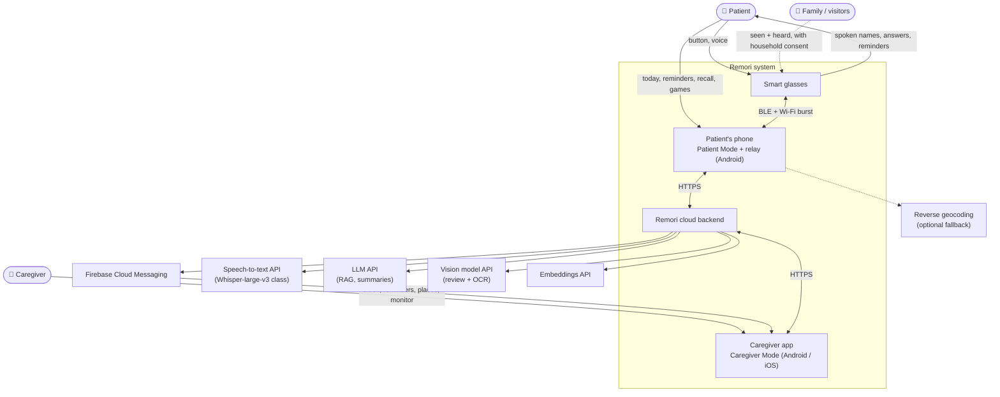
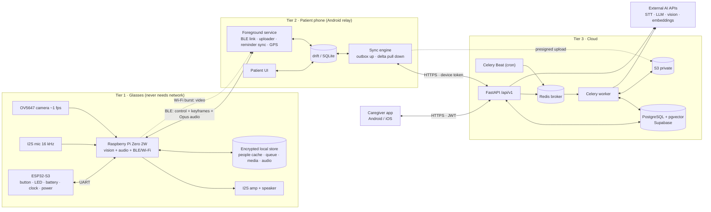
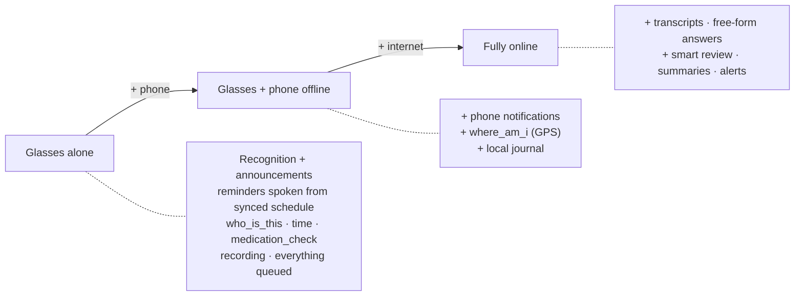
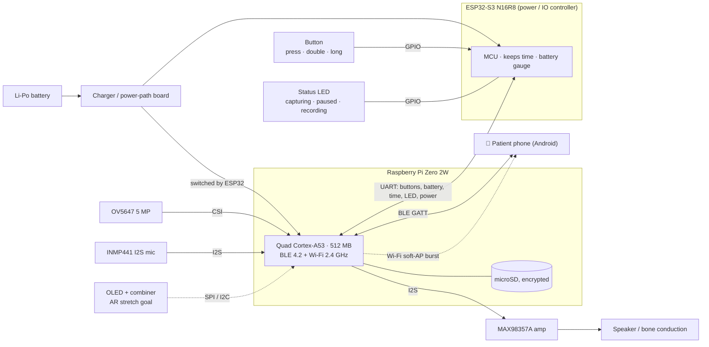
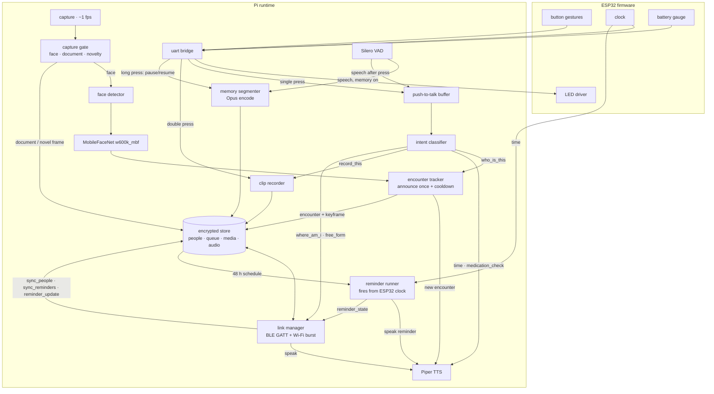
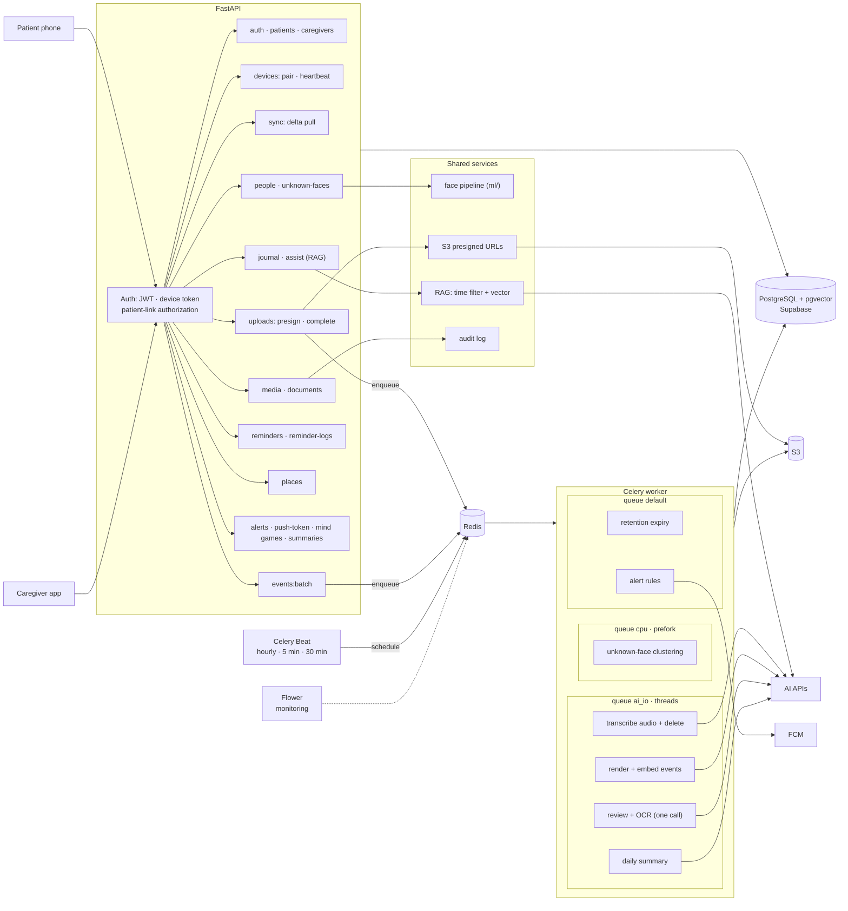
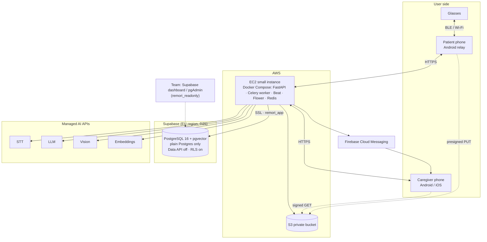
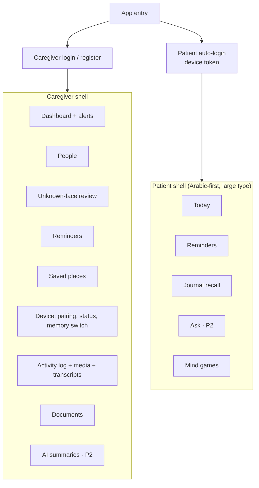
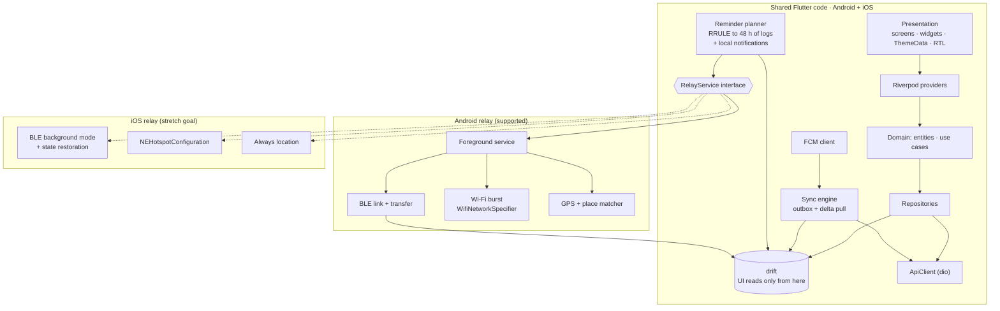

# 01 — Architecture (spec v1)

Decision references `D#` point to the decision log in [`REMORI_SPEC.md`](../../REMORI_SPEC.md) §0. Dashed lines = optional, stretch, or fallback paths.

---

## 1.1 System context

---

## 1.2 Three-tier container view

### Degradation

---

## 1.3 Glasses hardware block diagram (D7)

---

## 1.4 Glasses software modules (`hardware/pi`, `hardware/esp32`)

---

## 1.5 Backend component view (`backend-ai/`)

---

## 1.6 Deployment (D5, D25)

---

## 1.7 Flutter app navigation (GoRouter)

## 1.8 Flutter app layers (Riverpod, offline-first, cross-platform, D8)

Everything above the `RelayService` interface is shared Dart code running on Android and iOS. Only the relay has platform implementations.

