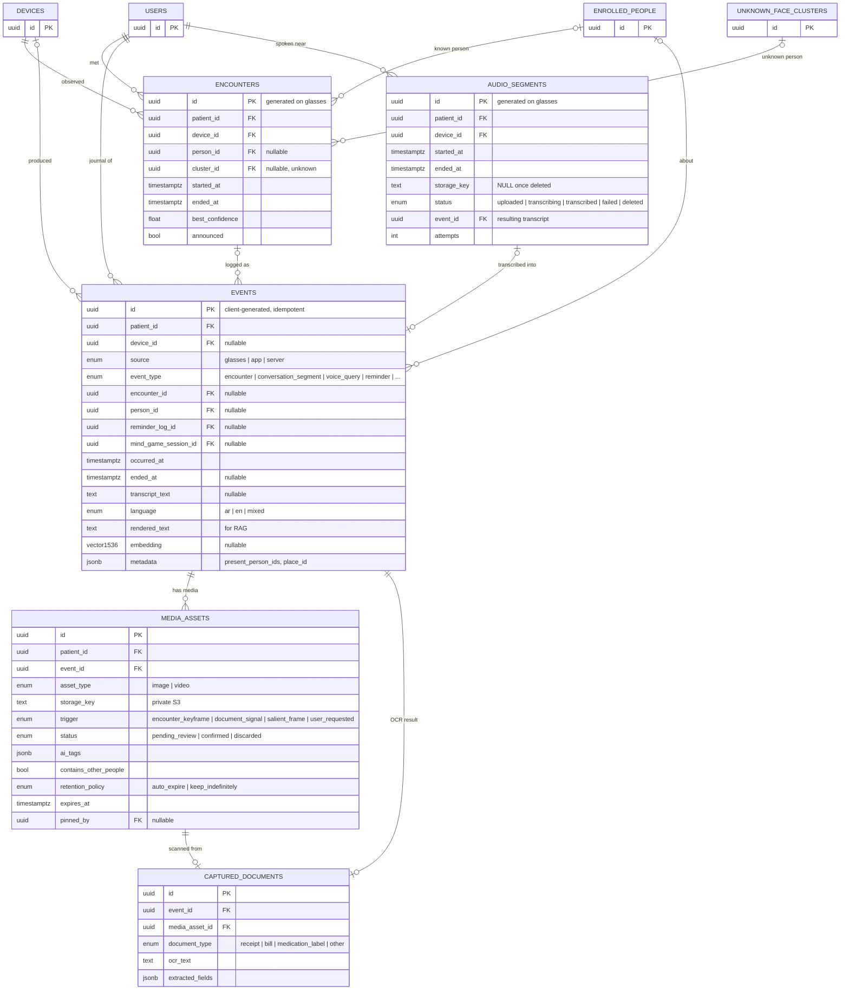
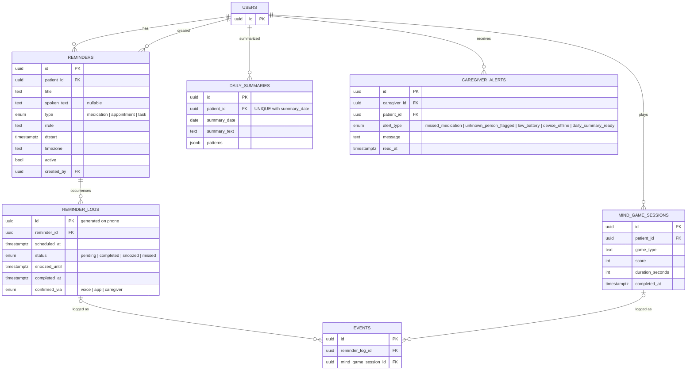

# 02 — Database ERD (spec v1, §6)

This is the target for the first Alembic migration. The original v0 model and its problems are recorded in [`SPEC_REVIEW.md`](../SPEC_REVIEW.md).
Mermaid can't express `VECTOR(n)` or enum values as types, so they appear as `vector512` etc., with enum values in the comment.

To keep it readable, the ERD is split into three views that share the `USERS` entity.

---

## 2.1 Accounts, devices, people, privacy

```mermaid
erDiagram
    USERS {
        uuid id PK
        enum role "patient | caregiver"
        text full_name
        text email UK "nullable"
        text phone
        text password_hash "nullable"
        timestamptz updated_at
        timestamptz deleted_at
    }
    PATIENT_PROFILES {
        uuid user_id PK, FK
        enum preferred_language "ar | en"
        text timezone "Africa/Cairo"
        date date_of_birth "nullable"
        bool memory_capture_enabled "caregiver master switch"
    }
    CAREGIVER_PATIENT_LINKS {
        uuid id PK
        uuid caregiver_id FK "UNIQUE with patient_id"
        uuid patient_id FK
        text relationship
        bool is_primary
        enum permission "viewer | manager"
    }
    REFRESH_TOKENS {
        uuid id PK
        uuid user_id FK
        text token_hash
        timestamptz expires_at
        timestamptz revoked_at
    }
    PUSH_TOKENS {
        uuid id PK
        uuid user_id FK
        text fcm_token
    }
    DEVICES {
        uuid id PK
        uuid patient_id FK
        text serial_number UK
        text token_hash
        text firmware_version
        int battery_level_pct
        timestamptz last_seen_at
        timestamptz paired_at
    }
    ENROLLED_PEOPLE {
        uuid id PK
        uuid patient_id FK
        text name
        text relationship
        enum added_by "caregiver_manual | promoted_from_unknown"
        uuid consent_record_id FK
        enum status "active | archived"
    }
    FACE_EMBEDDINGS {
        uuid id PK
        uuid person_id FK
        vector512 embedding
        text model_version "w600k_mbf@1.0"
        uuid source_media_id FK "nullable"
    }
    UNKNOWN_FACE_CLUSTERS {
        uuid id PK
        uuid patient_id FK
        vector512 centroid
        int sighting_count
        int distinct_days
        uuid sample_media_id FK
        enum status "open | awaiting_caregiver | promoted | dismissed"
        uuid promoted_person_id FK "nullable"
    }
    PLACES {
        uuid id PK
        uuid patient_id FK
        text name "Home"
        float latitude
        float longitude
        int radius_m
        uuid created_by FK
    }
    CONSENT_RECORDS {
        uuid id PK
        uuid patient_id FK
        uuid subject_person_id FK "nullable"
        enum consent_type "face_enrollment | ambient_audio_household | cloud_processing | media_retention"
        uuid given_by FK
        timestamptz given_at
        timestamptz revoked_at
    }
    AUDIT_LOG {
        uuid id PK
        uuid actor_user_id FK
        text action
        text entity_type
        uuid entity_id
        timestamptz at
    }

    USERS ||--o| PATIENT_PROFILES : "profile"
    USERS ||--o{ CAREGIVER_PATIENT_LINKS : "as caregiver"
    USERS ||--o{ CAREGIVER_PATIENT_LINKS : "as patient"
    AUTH_IDENTITIES {
        uuid id PK
        uuid user_id FK
        enum provider "google | facebook"
        text provider_subject "UNIQUE with provider"
        text email "nullable"
        bool email_verified
        timestamptz last_used_at "nullable"
    }
    USERS ||--o{ AUTH_IDENTITIES : "signs in with (D26)"
    USERS ||--o{ REFRESH_TOKENS : "sessions"
    USERS ||--o{ PUSH_TOKENS : "notified on"
    USERS ||--o{ DEVICES : "wears"
    USERS ||--o{ ENROLLED_PEOPLE : "knows"
    ENROLLED_PEOPLE ||--|{ FACE_EMBEDDINGS : "has"
    USERS ||--o{ UNKNOWN_FACE_CLUSTERS : "saw"
    UNKNOWN_FACE_CLUSTERS |o--o| ENROLLED_PEOPLE : "promoted to"
    USERS ||--o{ PLACES : "saved"
    USERS ||--o{ CONSENT_RECORDS : "gives"
    CONSENT_RECORDS |o--o| ENROLLED_PEOPLE : "covers"
    USERS ||--o{ AUDIT_LOG : "acted"
```

---

## 2.2 Journal, encounters, audio, media

---

## 2.3 Reminders, activity, insights

---

## 2.4 Where each table lives

| Table | Postgres | Phone (drift) | Glasses |
|---|---|---|---|
| users, profiles, links, devices | ✅ truth | own records | – |
| enrolled_people + face_embeddings | ✅ truth | cache | cache |
| unknown_face_clusters | ✅ | cache (caregiver) | – |
| encounters, events | ✅ | outbox + cache | queue until ack |
| audio_segments | until transcribed | queue | queue until ack |
| media_assets | metadata, bytes in S3 | pending uploads | bytes until ack |
| reminders, reminder_logs | ✅ | ✅ scheduler | today's schedule |
| places | ✅ | ✅ GPS matcher | – |
| mind_game_sessions | ✅ | outbox | – |
| summaries, alerts | ✅ | cache | – |
| consent_records, audit_log, tokens | ✅ only | – | – |
