# 03 — Sequence diagrams (spec v1)

Participants: **Patient** · **Caregiver** · **ESP32** · **Glasses** (Pi runtime) · **Phone** (patient's phone: Flutter app + Android relay service) · **CApp** (caregiver app, Android or iOS) · **API** (FastAPI) · **Worker** (Celery) · **DB** · **S3** · **AI** (external STT / LLM / vision / embeddings).

---

## 3.1 Caregiver onboarding + glasses pairing

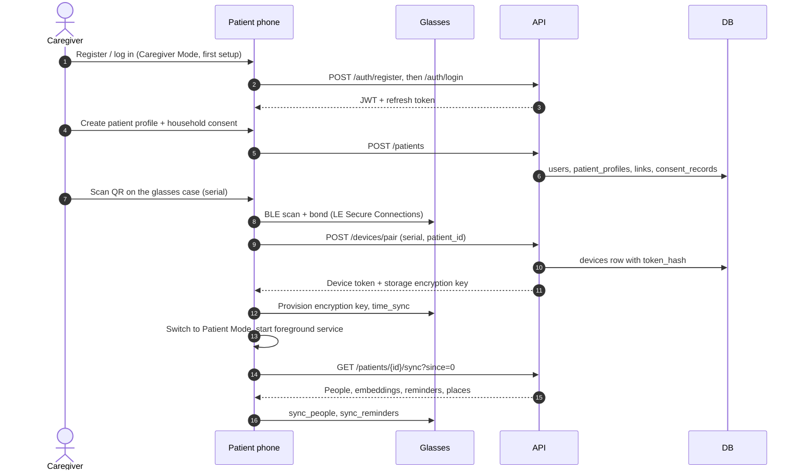

---

## 3.2 Enroll a person

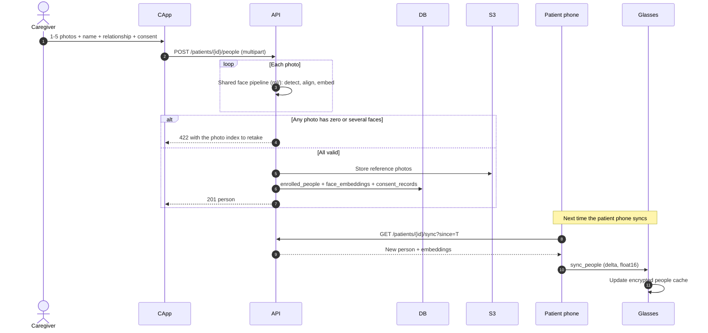

---

## 3.3 Real-time recognition with encounters (offline, D13)

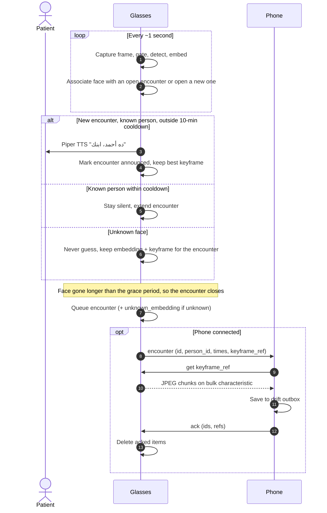

---

## 3.4 Ambient memory: speech to journal transcript (D1-D4)

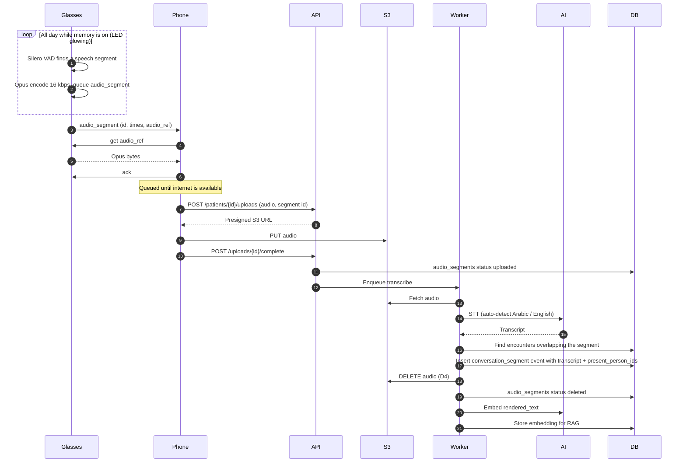

---

## 3.5 Fixed-intent question (button, offline)

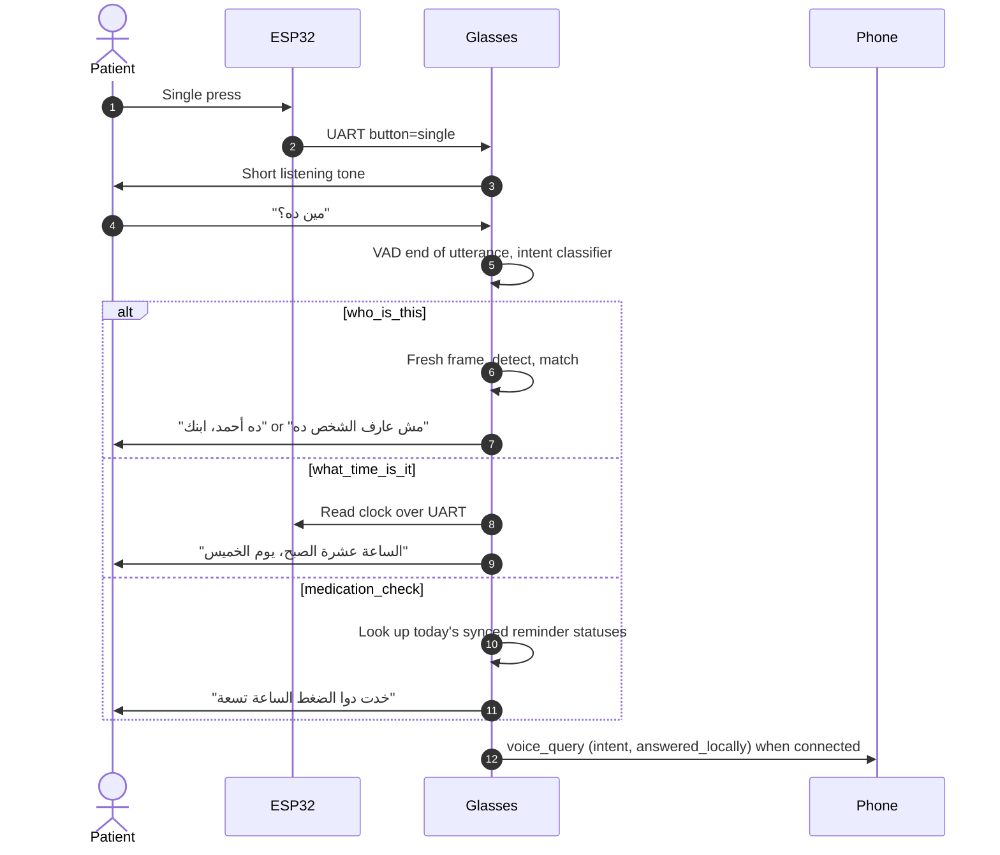

---

## 3.6 "Where am I?" (phone GPS + saved places, D9)

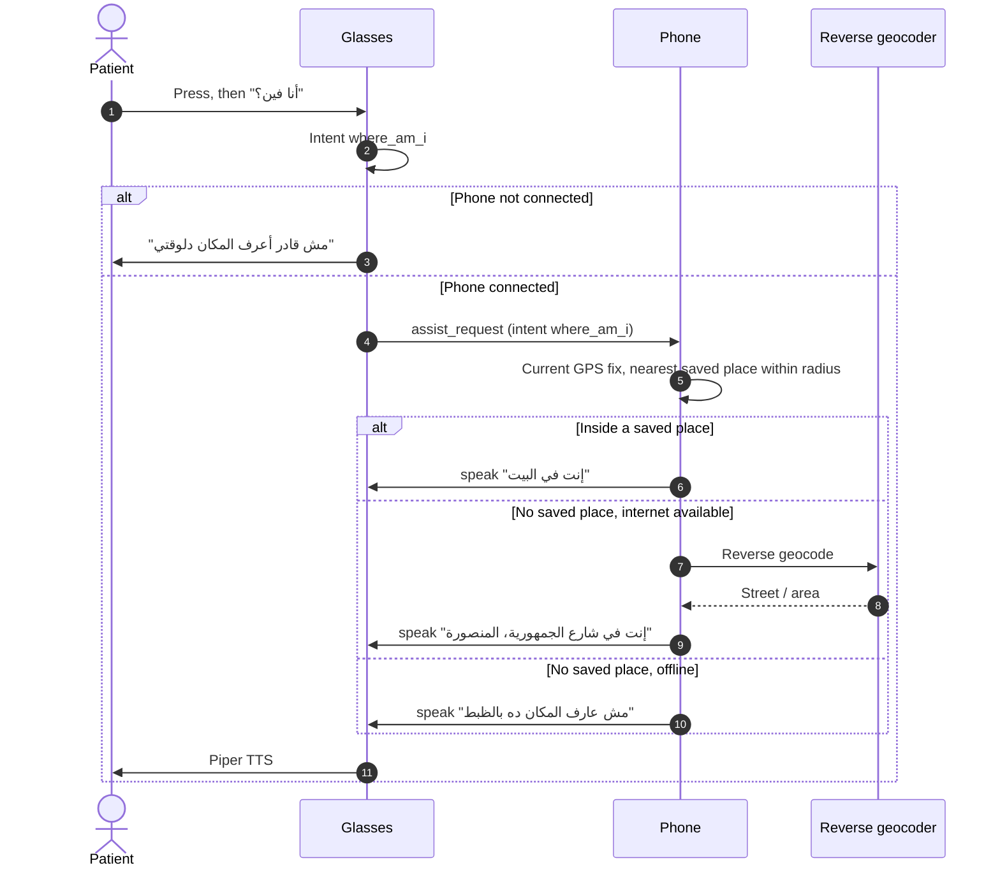

---

## 3.7 Free-form question (Phase 2 RAG)

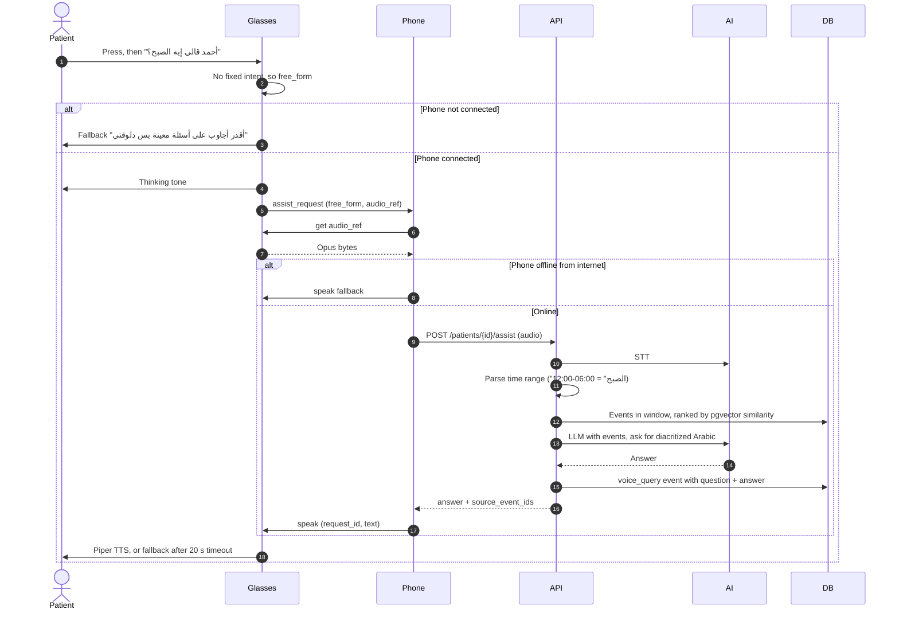

---

## 3.8 Reminder (D6)

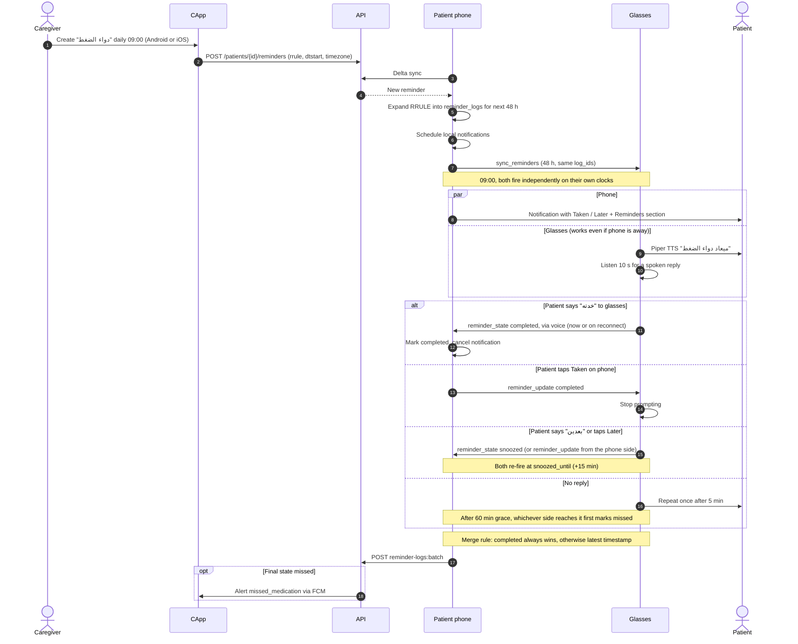

---

## 3.9 User-requested recording (double press, Wi-Fi burst)

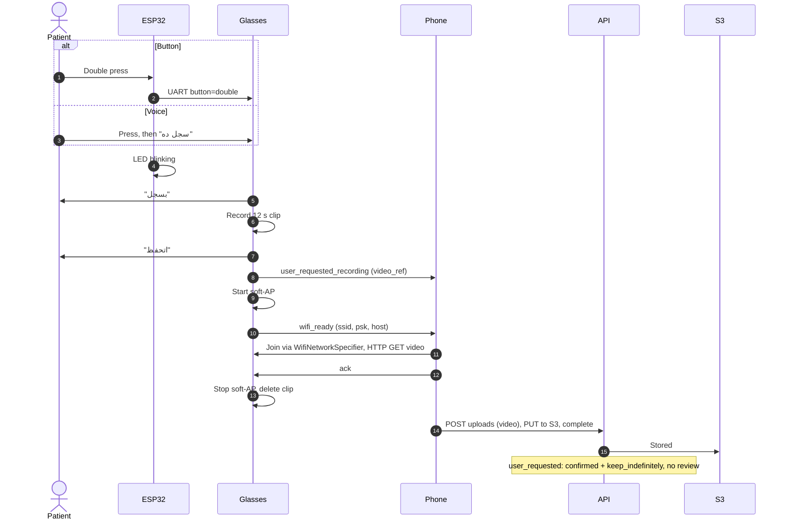

---

## 3.10 Smart review + OCR for gate-proposed frames (D20)

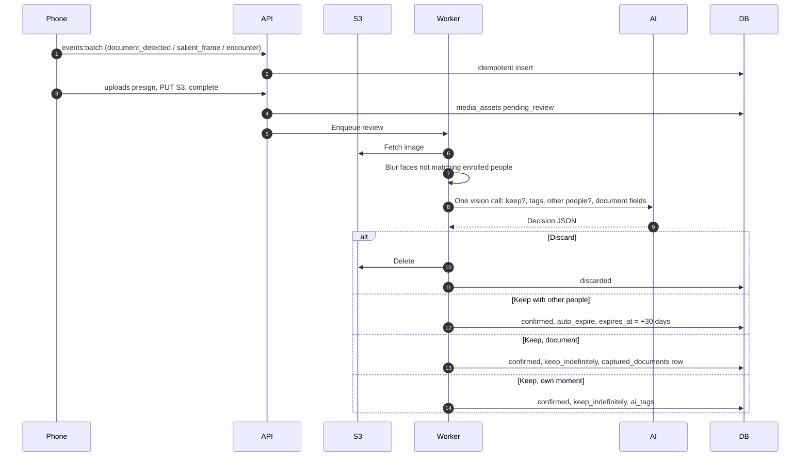

---

## 3.11 Unknown recurring face → caregiver (D23)

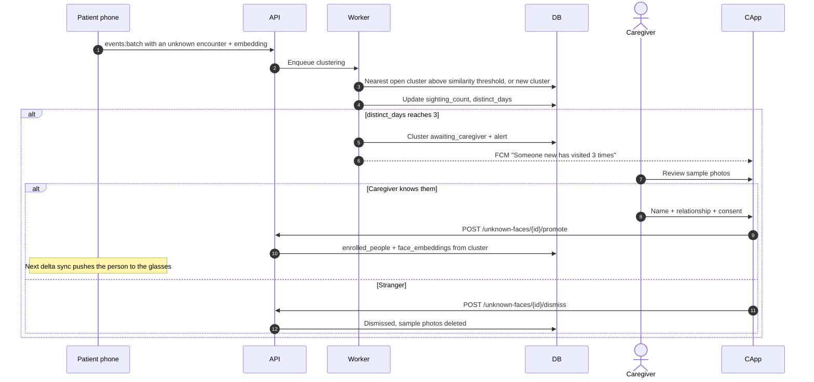

---

## 3.12 Nightly summary + alerts (Phase 2)

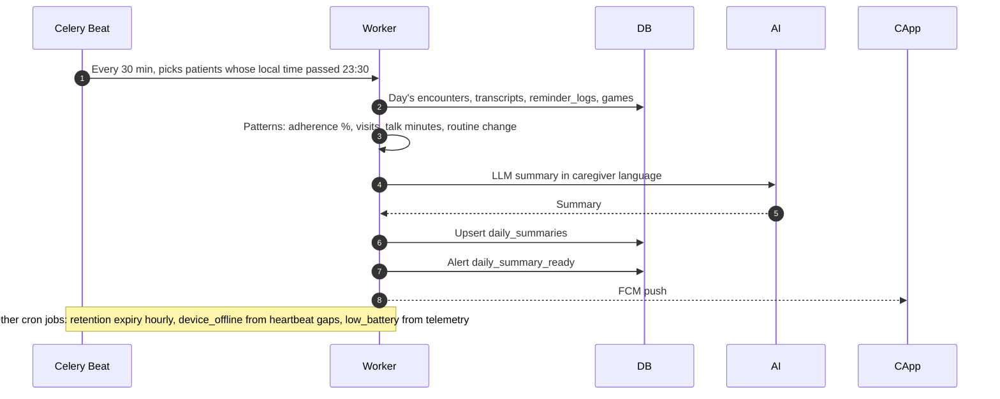
