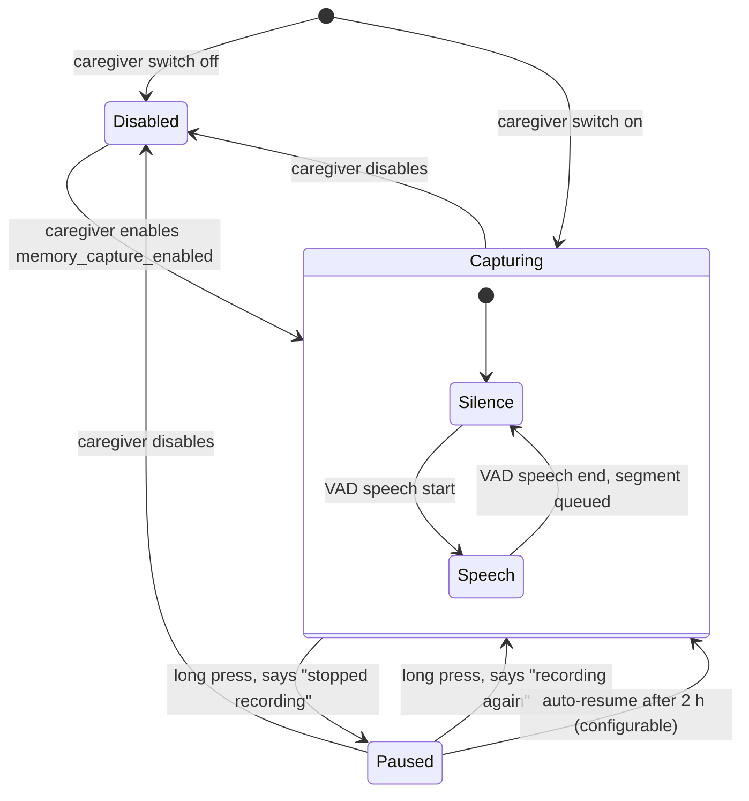
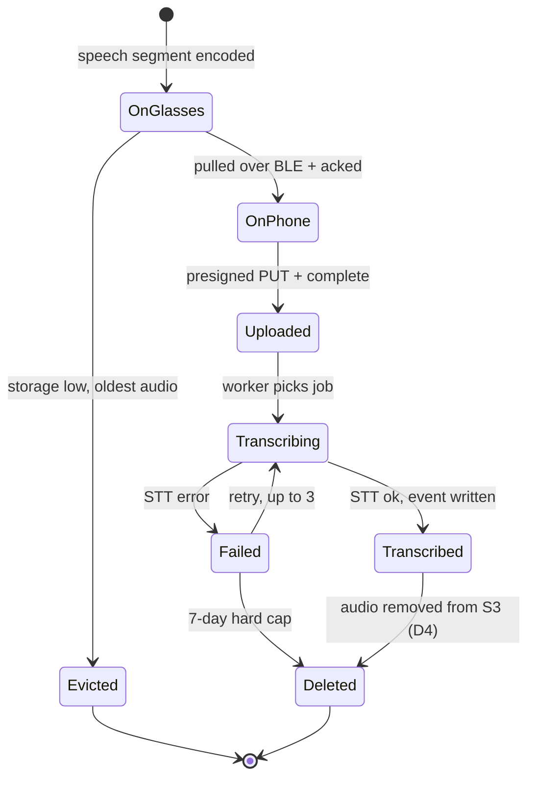
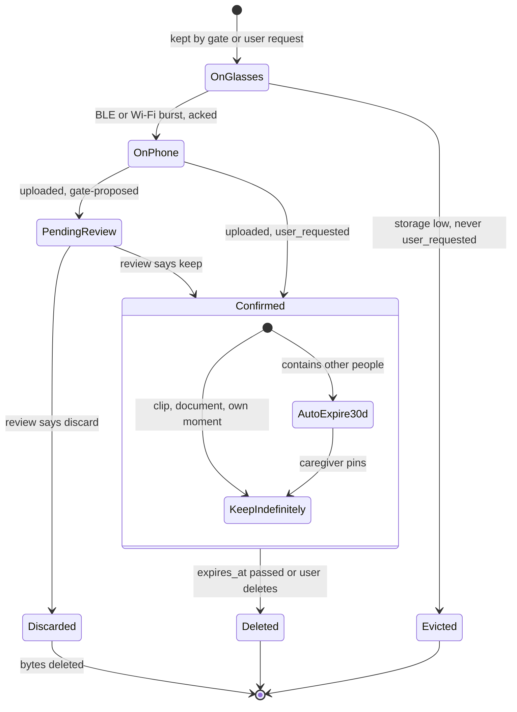
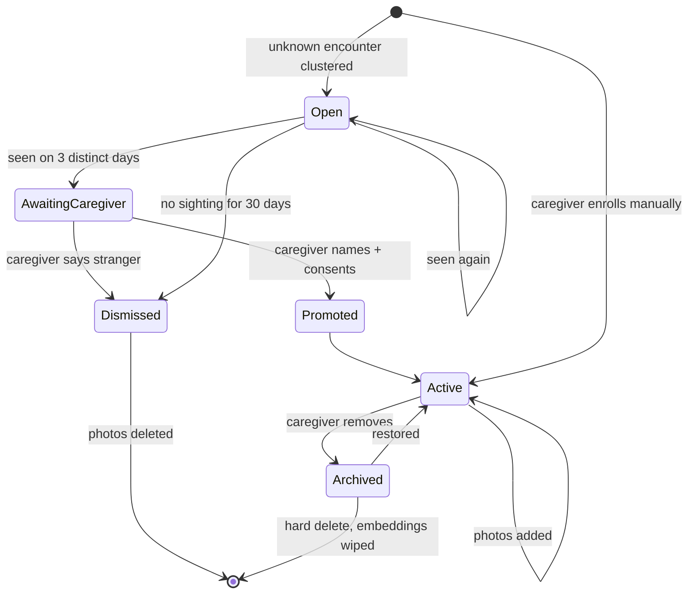
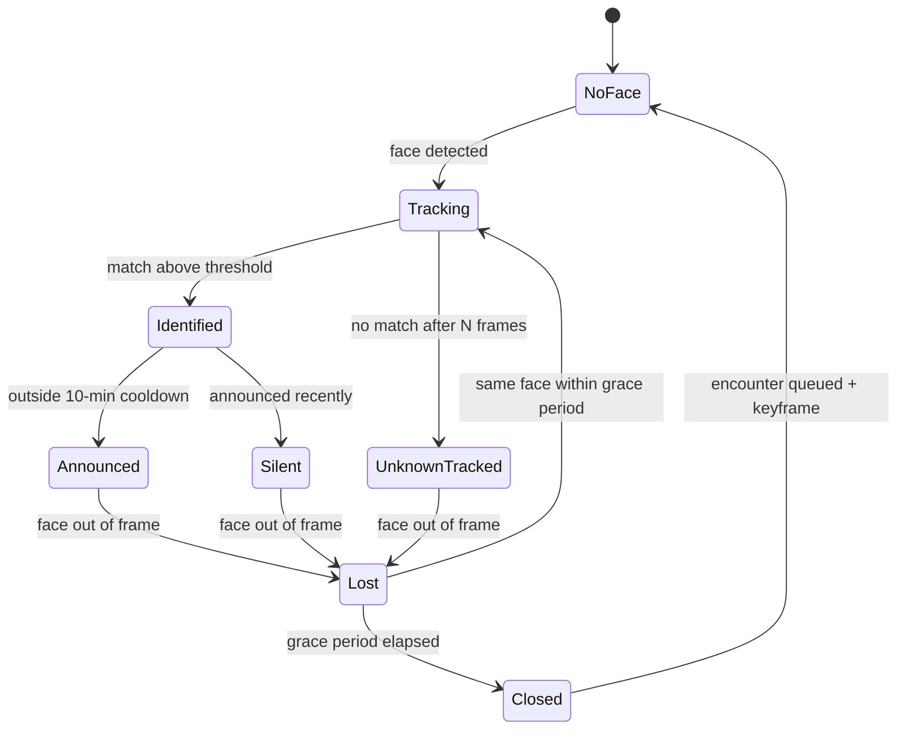
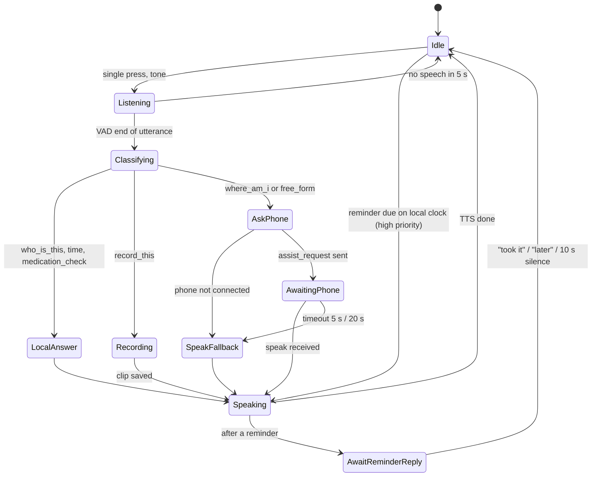
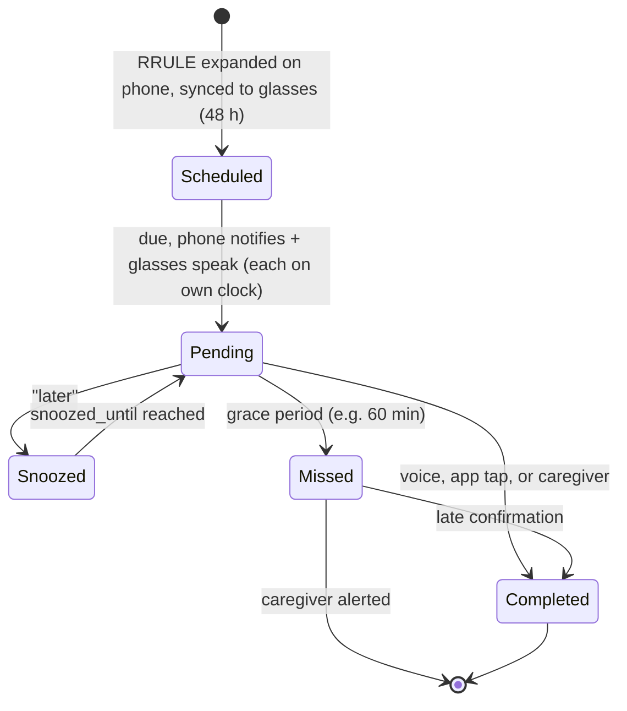
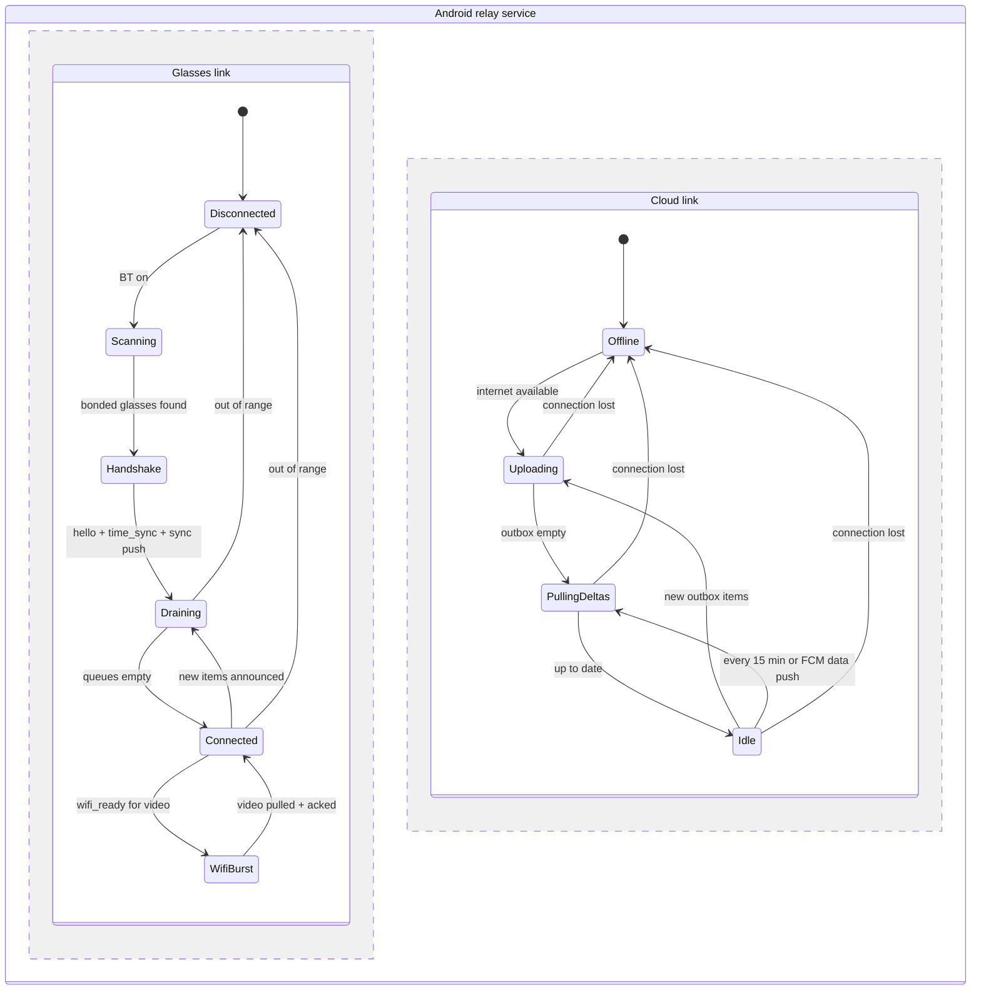

# 04 — State machines (spec v1)

Each lifecycle becomes a DB enum or a firmware/app state. All three tiers must agree on them.

---

## 4.1 Memory capture mode (glasses, D1 + D24)

LED: Capturing = soft glow · Paused / Disabled = off · clip recording = blinking.

---

## 4.2 Audio segment lifecycle (`audio_segments.status`)

---

## 4.3 Media asset lifecycle (`media_assets`, D10 / D20)

---

## 4.4 Face identity lifecycle (D23)

---

## 4.5 Encounter (D13)

---

## 4.6 Assistant interaction (D2, D9, D17)

---

## 4.7 Reminder occurrence (`reminder_logs.status`, D6)

The same `log_id` lives on the phone and the glasses. If they disagree, `completed` always wins, otherwise the latest timestamp wins (spec §7.1).

---

## 4.8 Phone relay: two independent links

