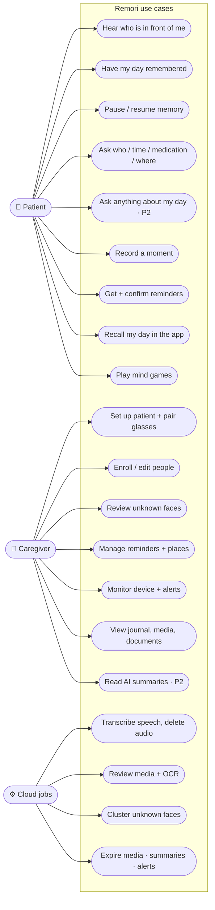
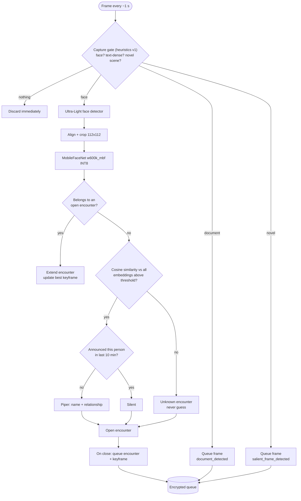
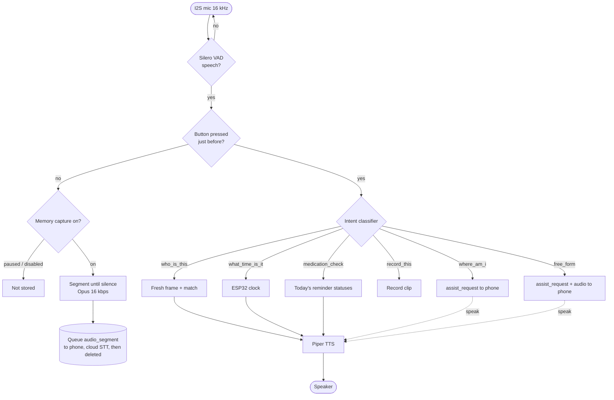
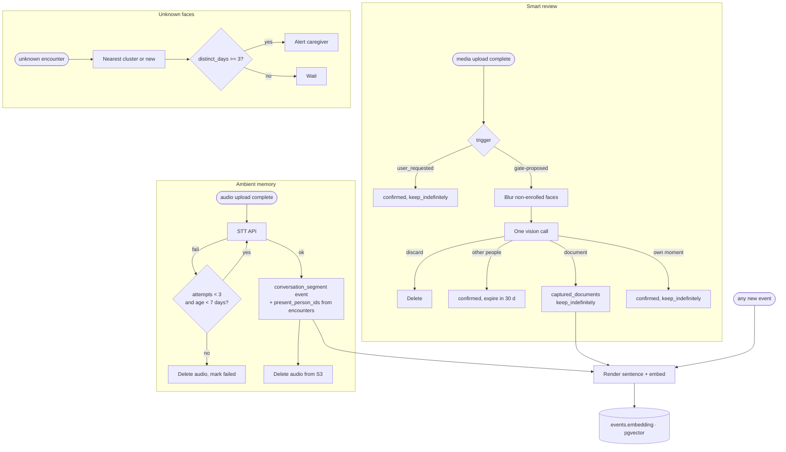
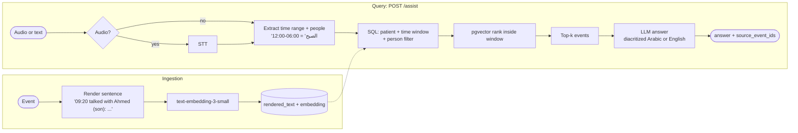
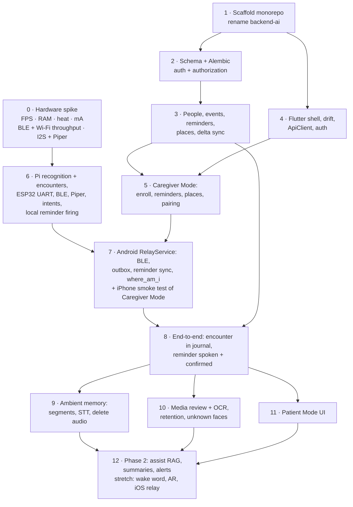

# 05 — Pipelines, use cases, build plan (spec v1)

---

## 5.1 Use cases by actor

---

## 5.2 On-device vision pipeline

---

## 5.3 On-device audio pipeline: two paths from one mic

The assistant utterance is also kept as memory (it's logged as a `voice_query` event), so it isn't duplicated as a conversation segment.

---

## 5.4 Cloud processing jobs

---

## 5.5 RAG: ingestion and query (Phase 2, D22)

---

## 5.6 Build order (spec §12)

